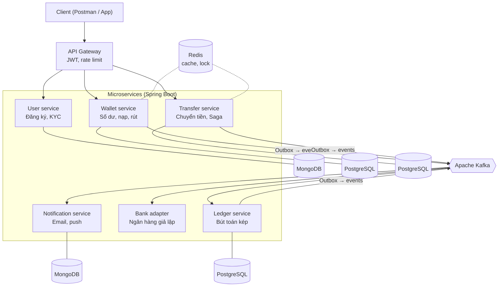
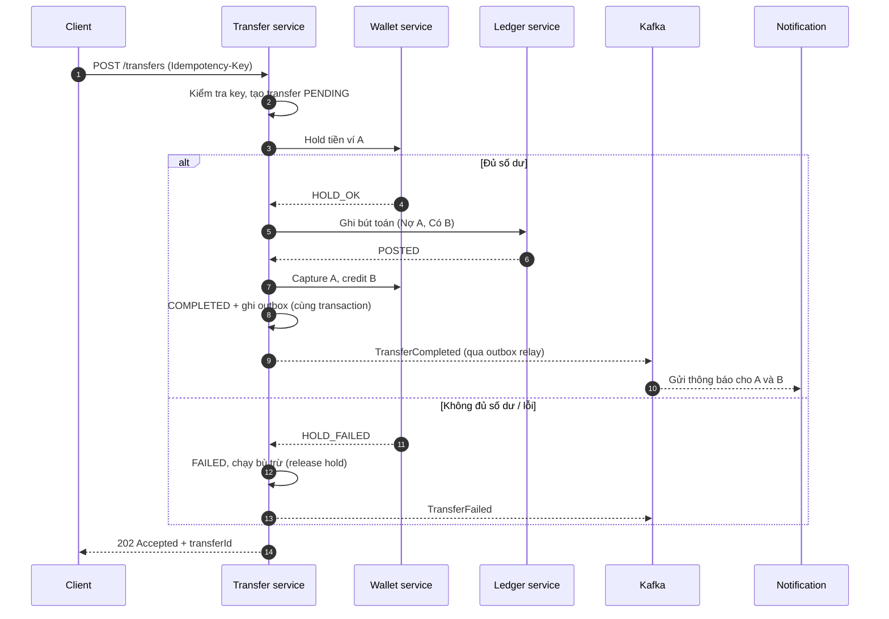
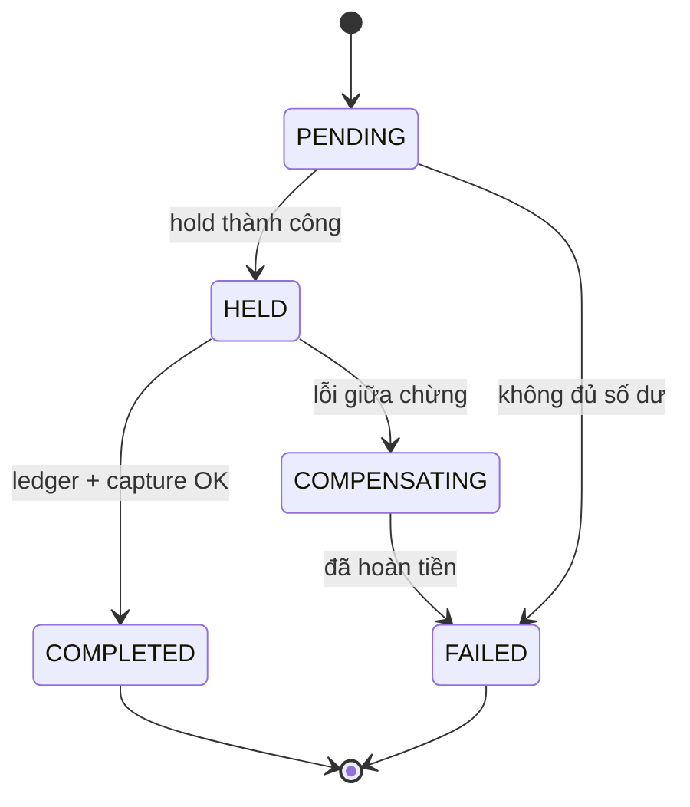
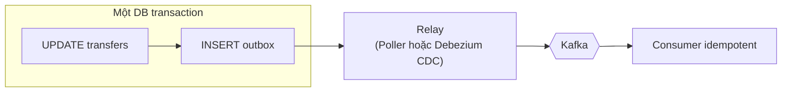
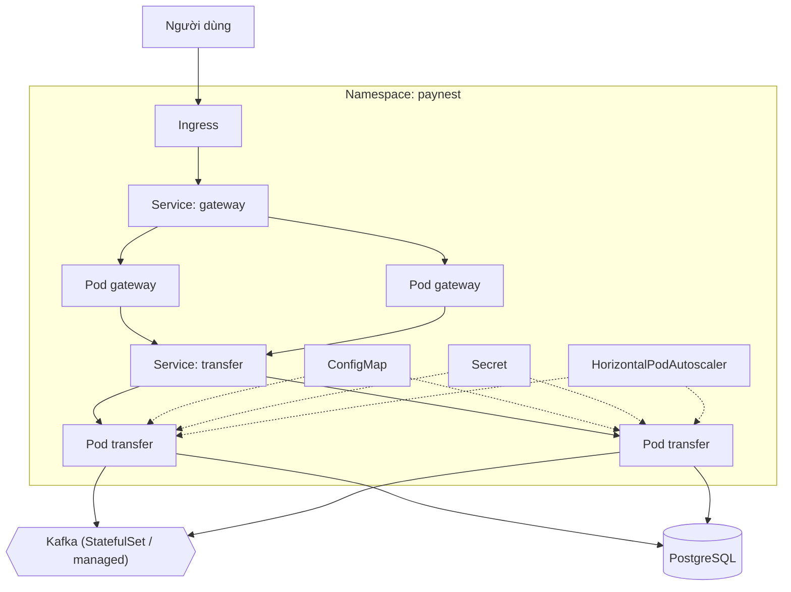
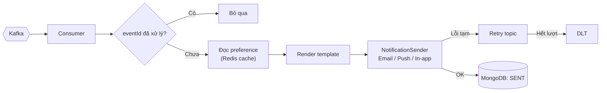

# 💳 PayNest — Ví điện tử Microservices (Java / Spring Boot)

> Dự án luyện tập kiến trúc microservices cho vị trí **Senior Java Developer**:
> Spring Boot, Kafka, Transactional Outbox, Saga, Kubernetes.

---

## Mục lục

1. [Kiến trúc tổng quan](#1-kiến-trúc-tổng-quan)
2. [Luồng chuyển tiền](#2-luồng-chuyển-tiền)
3. [Guide: Kafka](#3-guide-kafka)
4. [Guide: Transactional Outbox Pattern](#4-guide-transactional-outbox-pattern)
5. [Guide: Kubernetes](#5-guide-kubernetes)
6. [Notification service](#6-notification-service)
7. [Cấu trúc repo](#7-cấu-trúc-repo)
8. [Lộ trình 4 tuần](#8-lộ-trình-4-tuần)
9. [Tài liệu chính thức](#9-tài-liệu-chính-thức)

---

## 1. Kiến trúc tổng quan



| Service | Database | Trách nhiệm |
|---|---|---|
| user-service | MongoDB | Đăng ký, đăng nhập, KYC |
| wallet-service | PostgreSQL | Số dư, giữ tiền (hold), nạp/rút |
| transfer-service | PostgreSQL | Điều phối chuyển tiền (Saga orchestrator) |
| ledger-service | PostgreSQL | Sổ cái bút toán kép, bất biến |
| bank-adapter | — | Giả lập ngân hàng, cố tình lỗi/timeout ngẫu nhiên |
| notification-service | MongoDB | Gửi thông báo đa kênh |

> **Nguyên tắc:** mỗi service sở hữu database riêng (*database per service*). Service khác không bao giờ đọc thẳng DB của nhau.

---

## 2. Luồng chuyển tiền



**Trạng thái giao dịch:**



**Bất biến phải luôn đúng (viết test cho chúng):**
- Số dư không bao giờ âm.
- Tổng tiền toàn hệ thống không đổi sau mọi giao dịch nội bộ.
- Cùng `Idempotency-Key` → chỉ một giao dịch được tạo.

---

## 3. Guide: Kafka

### 3.1 Khái niệm cốt lõi

| Khái niệm | Ý nghĩa trong project |
|---|---|
| Topic | Kênh sự kiện, vd `wallet.transfer.events` |
| Partition | Đơn vị song song; **thứ tự chỉ đảm bảo trong 1 partition** |
| Key | Dùng `walletId` làm key → mọi sự kiện của 1 ví vào cùng partition, giữ đúng thứ tự |
| Consumer group | Mỗi service là 1 group; các instance chia nhau partition |
| Offset | Vị trí đã đọc; commit sau khi xử lý xong |

### 3.2 Chạy Kafka local (KRaft, không cần ZooKeeper)

```yaml
# docker-compose.yml (trích)
services:
  kafka:
    image: apache/kafka:latest
    ports: ["9092:9092"]
    environment:
      KAFKA_NODE_ID: 1
      KAFKA_PROCESS_ROLES: broker,controller
      KAFKA_LISTENERS: PLAINTEXT://:9092,CONTROLLER://:9093
      KAFKA_ADVERTISED_LISTENERS: PLAINTEXT://localhost:9092
      KAFKA_CONTROLLER_LISTENER_NAMES: CONTROLLER
      KAFKA_CONTROLLER_QUORUM_VOTERS: 1@localhost:9093
      KAFKA_OFFSETS_TOPIC_REPLICATION_FACTOR: 1
```

### 3.3 Producer an toàn

```yaml
spring:
  kafka:
    producer:
      acks: all
      properties:
        enable.idempotence: true   # chống ghi trùng khi producer retry
```

### 3.4 Consumer với retry + DLT (Spring for Apache Kafka)

```java
@RetryableTopic(
    attempts = "4",
    backoff = @Backoff(delay = 1000, multiplier = 5.0),
    dltTopicSuffix = ".dlt",
    exclude = { InvalidRecipientException.class } // lỗi vĩnh viễn: không retry
)
@KafkaListener(topics = "wallet.transfer.events", groupId = "notification-service")
public void onEvent(TransferEvent event) {
    if (processedEventRepo.existsById(event.eventId())) return; // idempotent consumer
    notificationHandler.handle(event);
    processedEventRepo.save(new ProcessedEvent(event.eventId()));
}

@DltHandler
public void onDlt(TransferEvent event) {
    log.error("Event vào DLT, cần xử lý thủ công: {}", event.eventId());
}
```

> ⚠️ Kafka đảm bảo **at-least-once** trong cấu hình thông thường → consumer **phải idempotent**.
> Theo tài liệu Spring Kafka, non-blocking retry không dùng được với batch listener và không kết hợp được với container transactions.

### 3.5 Checklist Kafka

- [ ] Key theo `walletId` / `transferId` để giữ thứ tự
- [ ] `enable.idempotence=true`, `acks=all`
- [ ] Consumer idempotent (bảng `processed_events`)
- [ ] Retry topic + DLT
- [ ] Schema sự kiện có `eventId`, `eventType`, `occurredAt`, `version`

---

## 4. Guide: Transactional Outbox Pattern

### 4.1 Vấn đề: dual write

```java
// ❌ SAI: hai thao tác, không cùng transaction
transferRepo.save(transfer);          // DB commit OK
kafkaTemplate.send("events", event);  // Kafka lỗi → mất sự kiện, hệ thống lệch
```

Nếu DB commit mà gửi Kafka thất bại (hoặc ngược lại), dữ liệu và sự kiện không còn khớp nhau.

### 4.2 Giải pháp



Ghi thay đổi nghiệp vụ **và** sự kiện vào bảng `outbox` trong **cùng một transaction**. Một tiến trình riêng (relay) đọc bảng outbox và publish lên Kafka.

### 4.3 Bảng outbox (tương thích cấu hình mặc định của Debezium)

```sql
CREATE TABLE outbox (
    id             UUID PRIMARY KEY,
    aggregatetype  VARCHAR(255) NOT NULL,  -- vd 'transfer' → topic outbox.event.transfer
    aggregateid    VARCHAR(255) NOT NULL,  -- dùng làm message key
    type           VARCHAR(255) NOT NULL,  -- vd 'TransferCompleted'
    payload        JSONB        NOT NULL,
    created_at     TIMESTAMPTZ  NOT NULL DEFAULT now()
);
```

```java
@Transactional
public void complete(Transfer transfer) {
    transfer.markCompleted();
    transferRepo.save(transfer);
    outboxRepo.save(OutboxEvent.of("transfer", transfer.getId(),
                                   "TransferCompleted", toJson(transfer)));
}
```

### 4.4 Hai cách làm relay

| Cách | Ưu điểm | Nhược điểm |
|---|---|---|
| **Polling publisher** (`@Scheduled` + `SELECT ... FOR UPDATE SKIP LOCKED`) | Đơn giản, không thêm hạ tầng | Có độ trễ, tốn query DB |
| **Debezium CDC** (đọc WAL của PostgreSQL) | Gần realtime, không polling | Thêm Kafka Connect + Debezium |

Debezium cung cấp sẵn SMT `io.debezium.transforms.outbox.EventRouter`:

```properties
transforms=outbox
transforms.outbox.type=io.debezium.transforms.outbox.EventRouter
```

> Lưu ý: outbox **không** cho exactly-once end-to-end. Relay vẫn có thể gửi trùng → consumer phía sau vẫn phải idempotent.

---

## 5. Guide: Kubernetes

### 5.1 Mô hình triển khai



### 5.2 Deployment mẫu

```yaml
apiVersion: apps/v1
kind: Deployment
metadata:
  name: transfer-service
  namespace: paynest
spec:
  replicas: 2
  selector:
    matchLabels: { app: transfer-service }
  template:
    metadata:
      labels: { app: transfer-service }
    spec:
      containers:
        - name: app
          image: ghcr.io/<you>/transfer-service:1.0.0
          ports: [{ containerPort: 8080 }]
          envFrom:
            - configMapRef: { name: transfer-config }
            - secretRef:    { name: transfer-secret }
          resources:
            requests: { cpu: "250m", memory: "512Mi" }
            limits:   { memory: "768Mi" }
          startupProbe:
            httpGet: { path: /actuator/health/liveness, port: 8080 }
            failureThreshold: 30
            periodSeconds: 5
          readinessProbe:
            httpGet: { path: /actuator/health/readiness, port: 8080 }
            periodSeconds: 10
          livenessProbe:
            httpGet: { path: /actuator/health/liveness, port: 8080 }
            periodSeconds: 10
            failureThreshold: 3
---
apiVersion: v1
kind: Service
metadata:
  name: transfer-service
  namespace: paynest
spec:
  selector: { app: transfer-service }
  ports: [{ port: 80, targetPort: 8080 }]
```

Bật probe trong Spring Boot:

```yaml
management:
  endpoint:
    health:
      probes:
        enabled: true
```

### 5.3 Ghi nhớ về probe

- **startupProbe**: cho JVM thời gian khởi động; liveness và readiness chỉ chạy sau khi nó thành công.
- **readinessProbe**: pod chưa sẵn sàng thì không nhận traffic (vd Kafka/DB chưa kết nối).
- **livenessProbe**: chỉ dùng để phát hiện lỗi **không tự phục hồi** (deadlock). Cấu hình sai có thể gây restart dây chuyền — **không** kiểm tra DB/Kafka trong liveness.

### 5.4 Chạy local

```bash
# Dùng kind hoặc minikube
kind create cluster --name paynest
kubectl create namespace paynest
kubectl apply -f k8s/ -n paynest
kubectl get pods -n paynest -w
```

---

## 6. Notification service



API: `GET /notifications`, `PATCH /notifications/{id}/read`, `GET /notifications/unread-count`, `PUT /preferences`.

---

## 7. Cấu trúc repo

```
paynest/
├── services/
│   ├── api-gateway/
│   ├── user-service/
│   ├── wallet-service/
│   ├── transfer-service/
│   ├── ledger-service/
│   ├── bank-adapter/
│   └── notification-service/
├── libs/
│   └── common-events/        # DTO sự kiện dùng chung
├── infra/
│   ├── docker-compose.yml    # Kafka, Postgres, Mongo, Redis
│   └── debezium/             # connector config
├── k8s/                      # manifest Kubernetes
├── load-test/                # k6 / Gatling: 1.000 chuyển tiền đồng thời
└── .github/workflows/        # CI/CD
```

---

## 8. Lộ trình 4 tuần

| Tuần | Mục tiêu | Kết quả kiểm chứng |
|---|---|---|
| 1 | User + Wallet, JWT, nạp/rút | Test tích hợp với Testcontainers |
| 2 | Transfer + Ledger, idempotency, optimistic locking | 1.000 request đồng thời, số dư không âm |
| 3 | Kafka, Outbox, Saga, Bank adapter lỗi ngẫu nhiên | Tắt Kafka giữa chừng, bật lại không mất sự kiện |
| 4 | Notification, Kubernetes, CI/CD, monitoring | `kubectl apply` chạy toàn bộ hệ thống |

---

## 9. Tài liệu chính thức

**Kafka**
- Apache Kafka Documentation — https://kafka.apache.org/documentation/
- Apache Kafka Quickstart — https://kafka.apache.org/quickstart
- Spring for Apache Kafka Reference — https://docs.spring.io/spring-kafka/reference/
- Spring Kafka: Non-Blocking Retries (`@RetryableTopic`) — https://docs.spring.io/spring-kafka/reference/retrytopic.html

**Outbox**
- Debezium: Outbox Event Router — https://debezium.io/documentation/reference/stable/transformations/outbox-event-router.html
- Debezium: MongoDB Outbox Event Router — https://debezium.io/documentation/reference/stable/transformations/mongodb-outbox-event-router.html
- Pattern: Transactional Outbox (Chris Richardson, microservices.io) — https://microservices.io/patterns/data/transactional-outbox.html
- Pattern: Saga — https://microservices.io/patterns/data/saga.html

**Kubernetes**
- Kubernetes Documentation — https://kubernetes.io/docs/home/
- Deployments — https://kubernetes.io/docs/concepts/workloads/controllers/deployment/
- Configure Liveness, Readiness and Startup Probes — https://kubernetes.io/docs/tasks/configure-pod-container/configure-liveness-readiness-probes/
- ConfigMaps — https://kubernetes.io/docs/concepts/configuration/configmap/
- Secrets — https://kubernetes.io/docs/concepts/configuration/secret/
- Horizontal Pod Autoscaling — https://kubernetes.io/docs/tasks/run-application/horizontal-pod-autoscale/
- kind (Kubernetes in Docker) — https://kind.sigs.k8s.io/

**Spring Boot**
- Spring Boot Actuator: Kubernetes probes — https://docs.spring.io/spring-boot/reference/actuator/endpoints.html#actuator.endpoints.kubernetes-probes
- Testcontainers for Java — https://java.testcontainers.org/

**Mermaid**
- Mermaid Documentation — https://mermaid.js.org/intro/

---

*Dự án học tập — không xử lý tiền thật.*
