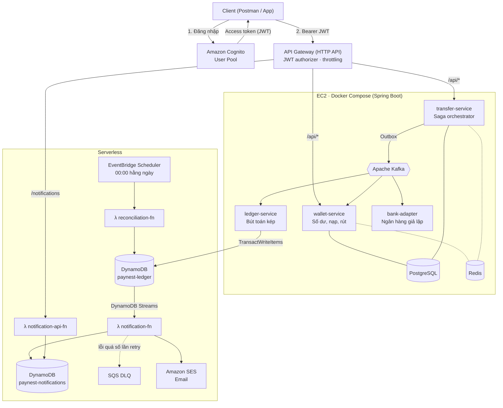
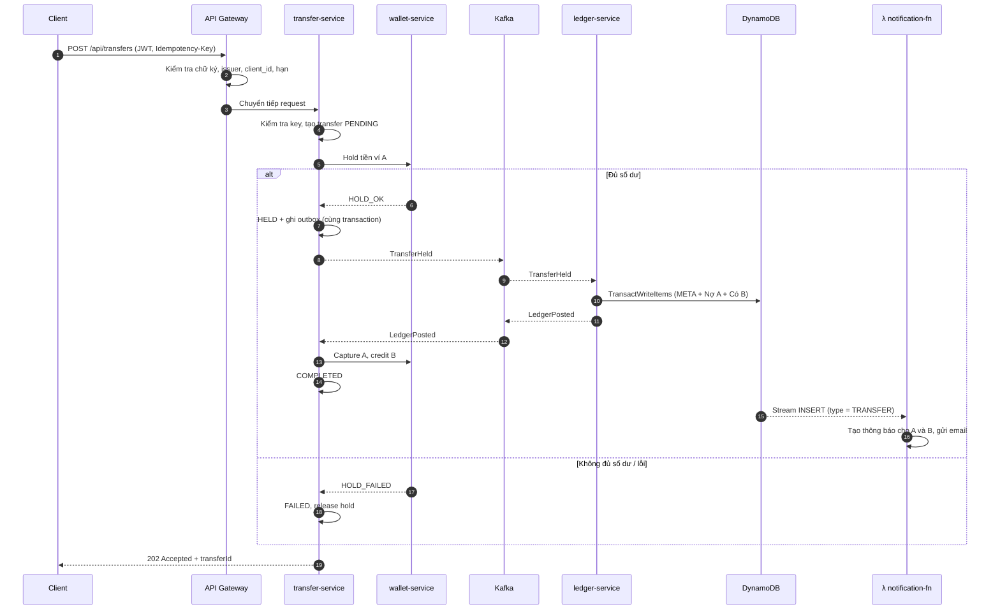
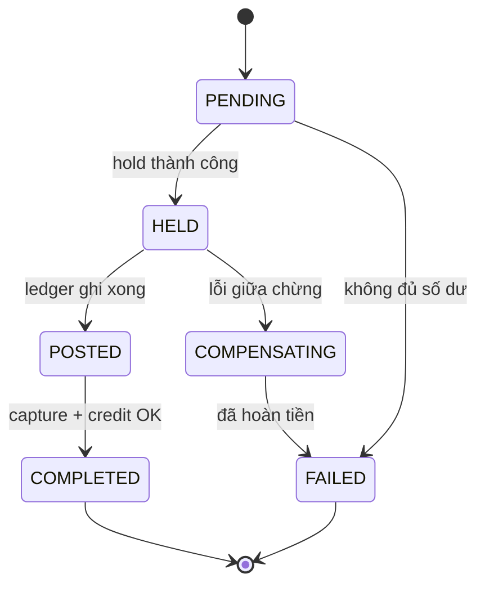
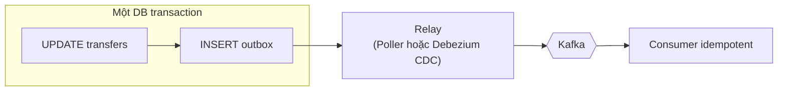
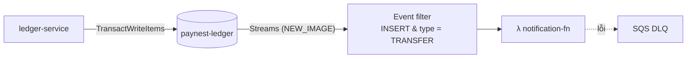
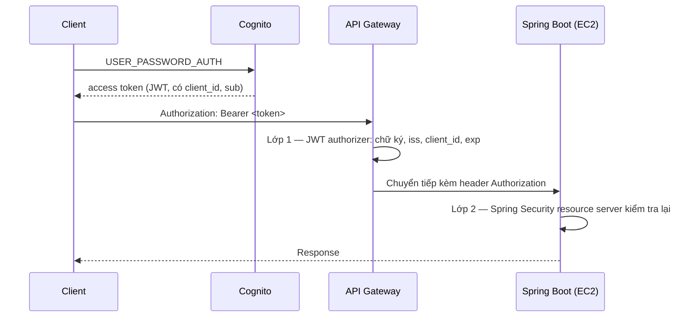
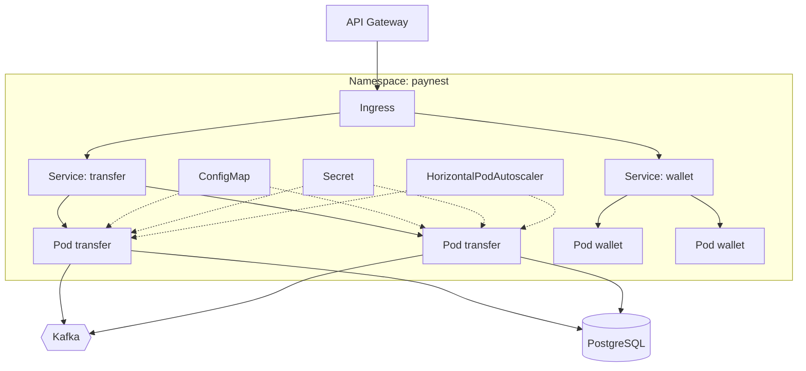

# 💳 PayNest — Ví điện tử Hybrid: Microservices + Serverless

> Dự án luyện tập cho vị trí **Senior Java Developer**: Spring Boot, Kafka, Transactional Outbox, Saga, Kubernetes
> **kết hợp** AWS Serverless: Cognito, API Gateway, Lambda, DynamoDB.

Lõi xử lý tiền chạy **Spring Boot microservices**; các phần hướng sự kiện, chạy theo lịch hoặc ít tải chạy **serverless**. Mục tiêu không chỉ là "làm được" mà là **giải thích được vì sao chọn công nghệ nào cho phần nào**.

---

## Mục lục

1. [Kiến trúc tổng quan](#1-kiến-trúc-tổng-quan)
2. [Vì sao chia như vậy](#2-vì-sao-chia-như-vậy)
3. [Luồng chuyển tiền](#3-luồng-chuyển-tiền)
4. [Guide: Kafka](#4-guide-kafka)
5. [Guide: Transactional Outbox & DynamoDB Streams](#5-guide-transactional-outbox--dynamodb-streams)
6. [Guide: Serverless (Cognito, API Gateway, Lambda, DynamoDB)](#6-guide-serverless)
7. [Guide: Kubernetes](#7-guide-kubernetes)
8. [Cấu trúc repo](#8-cấu-trúc-repo)
9. [Lộ trình 6 tuần](#9-lộ-trình-6-tuần)
10. [Tài liệu liên quan](#10-tài-liệu-liên-quan)
11. [Tài liệu chính thức](#11-tài-liệu-chính-thức)

---

## 1. Kiến trúc tổng quan



| Thành phần | Chạy ở | Lưu trữ | Trách nhiệm |
|---|---|---|---|
| Cognito User Pool | Serverless | Cognito | Đăng ký, đăng nhập, MFA, phát JWT |
| API Gateway (HTTP API) | Serverless | — | Cửa vào duy nhất, xác thực JWT, throttling |
| wallet-service | EC2 | PostgreSQL | Số dư, giữ tiền (hold), nạp/rút |
| transfer-service | EC2 | PostgreSQL | Điều phối chuyển tiền (Saga) + Outbox |
| ledger-service | EC2 | **DynamoDB** | Sổ cái bất biến, ghi nguyên tử |
| bank-adapter | EC2 | — | Giả lập ngân hàng, cố tình lỗi/timeout |
| notification-fn | Lambda | DynamoDB | Nghe Streams, tạo thông báo, gửi email |
| notification-api-fn | Lambda | DynamoDB | `GET /notifications`, đánh dấu đã đọc |
| reconciliation-fn | Lambda | — | Đối soát sổ cái mỗi đêm |

> **Đã bỏ so với bản trước:** `api-gateway` (Spring Cloud Gateway) → API Gateway; `user-service` → Cognito; `notification-service` + MongoDB → Lambda + DynamoDB.

---

## 2. Vì sao chia như vậy

Đây là phần nên nói được khi phỏng vấn system design.

| Quyết định | Lý do | Đánh đổi |
|---|---|---|
| Giữ **Spring Boot + PostgreSQL** cho wallet/transfer | Luồng tiền cần transaction ACID, truy vấn linh hoạt, latency ổn định; Saga phức tạp dễ kiểm soát trong code | Phải tự vận hành server |
| **Kafka** giữa các service lõi | Thứ tự theo partition, replay sự kiện, throughput cao | Hạ tầng nặng |
| **Cognito** thay `user-service` | Bảo mật đăng nhập là thứ không nên tự viết; có sẵn MFA, reset mật khẩu, JWKS | Tùy biến giao diện/luồng bị giới hạn |
| **API Gateway** thay Spring Cloud Gateway | Xác thực JWT, throttling, access log mà không cần code | Ít linh hoạt hơn khi cần logic routing phức tạp |
| **DynamoDB** cho ledger | Sổ cái là append-only, truy cập theo khóa (`walletId`) — đúng thế mạnh của DynamoDB; Streams cho CDC có sẵn | Báo cáo, truy vấn ad-hoc khó hơn SQL |
| **Lambda** cho notification | Bản chất "có sự kiện thì chạy", tải không đều → trả tiền theo lượt chạy | Cold start (giảm bằng SnapStart) |
| **Lambda + Scheduler** cho đối soát | Chạy 1 lần/ngày, không cần server 24/7 | Giới hạn 15 phút mỗi lần chạy |

**Câu hỏi tự kiểm tra:** *Nếu ví A và B cùng nằm trong DynamoDB, có cần Saga không?*
→ Không nhất thiết: `TransactWriteItems` trừ A, cộng B, ghi ledger trong **một** giao dịch nguyên tử (tối đa 100 thao tác). Saga chỉ cần khi giao dịch vắt qua nhiều hệ thống không chung transaction — như PostgreSQL ↔ DynamoDB ↔ ngân hàng trong dự án này.

---

## 3. Luồng chuyển tiền



**Trạng thái giao dịch:**



**Bất biến phải luôn đúng (viết test cho chúng):**
- Số dư không bao giờ âm.
- Mỗi giao dịch trong ledger có tổng bút toán = 0.
- Tổng tiền toàn hệ thống không đổi sau mọi giao dịch nội bộ.
- Cùng `Idempotency-Key` → chỉ một giao dịch; cùng sự kiện → chỉ một bản ghi ledger, một thông báo.

---

## 4. Guide: Kafka

### 4.1 Khái niệm cốt lõi

| Khái niệm | Ý nghĩa trong project |
|---|---|
| Topic | Kênh sự kiện, vd `wallet.transfer.events` |
| Partition | Đơn vị song song; **thứ tự chỉ đảm bảo trong 1 partition** |
| Key | Dùng `transferId` làm key → mọi sự kiện của 1 giao dịch vào cùng partition, giữ đúng thứ tự |
| Consumer group | Mỗi service là 1 group; các instance chia nhau partition |
| Offset | Vị trí đã đọc; commit sau khi xử lý xong |

### 4.2 Chạy Kafka local (KRaft, không cần ZooKeeper)

```yaml
# infra/docker-compose.yml (trích)
services:
  kafka:
    image: apache/kafka:latest
    ports: ["9092:9092"]
    environment:
      KAFKA_NODE_ID: 1
      KAFKA_PROCESS_ROLES: broker,controller
      KAFKA_LISTENERS: PLAINTEXT://:9092,CONTROLLER://:9093
      KAFKA_ADVERTISED_LISTENERS: PLAINTEXT://localhost:9092
      KAFKA_CONTROLLER_LISTENER_NAMES: CONTROLLER
      KAFKA_CONTROLLER_QUORUM_VOTERS: 1@localhost:9093
      KAFKA_OFFSETS_TOPIC_REPLICATION_FACTOR: 1
```

### 4.3 Producer an toàn

```yaml
spring:
  kafka:
    producer:
      acks: all
      properties:
        enable.idempotence: true   # chống ghi trùng khi producer retry
```

### 4.4 Consumer với retry + DLT (Spring for Apache Kafka)

```java
@RetryableTopic(
    attempts = "4",
    backoff = @Backoff(delay = 1000, multiplier = 5.0),
    dltTopicSuffix = ".dlt",
    exclude = { InvalidTransferException.class } // lỗi vĩnh viễn: không retry
)
@KafkaListener(topics = "wallet.transfer.events", groupId = "ledger-service")
public void onEvent(TransferHeld event) {
    ledgerWriter.record(event);   // idempotent nhờ ConditionExpression trong DynamoDB (mục 6.4)
}

@DltHandler
public void onDlt(TransferHeld event) {
    log.error("Event vào DLT, cần xử lý thủ công: {}", event.transferId());
}
```

> ⚠️ Kafka đảm bảo **at-least-once** trong cấu hình thông thường → consumer **phải idempotent**.
> Non-blocking retry của Spring Kafka không dùng được với batch listener và không kết hợp được với container transactions.

### 4.5 Checklist Kafka

- [ ] Key theo `transferId` để giữ thứ tự
- [ ] `enable.idempotence=true`, `acks=all`
- [ ] Consumer idempotent
- [ ] Retry topic + DLT
- [ ] Schema sự kiện có `eventId`, `eventType`, `occurredAt`, `version`

---

## 5. Guide: Transactional Outbox & DynamoDB Streams

Dự án dùng **hai cách** giải bài toán dual write — để so sánh.

### 5.1 Vấn đề: dual write

```java
// ❌ SAI: hai thao tác, không cùng transaction
transferRepo.save(transfer);          // DB commit OK
kafkaTemplate.send("events", event);  // Kafka lỗi → mất sự kiện
```

### 5.2 Cách 1 — Outbox trên PostgreSQL (transfer-service)



```sql
CREATE TABLE outbox (
    id             UUID PRIMARY KEY,
    aggregatetype  VARCHAR(255) NOT NULL,  -- 'transfer' → topic outbox.event.transfer
    aggregateid    VARCHAR(255) NOT NULL,  -- message key
    type           VARCHAR(255) NOT NULL,  -- 'TransferHeld'
    payload        JSONB        NOT NULL,
    created_at     TIMESTAMPTZ  NOT NULL DEFAULT now()
);
```

```java
@Transactional
public void markHeld(Transfer transfer) {
    transfer.markHeld();
    transferRepo.save(transfer);
    outboxRepo.save(OutboxEvent.of("transfer", transfer.getId(),
                                   "TransferHeld", toJson(transfer)));
}
```

| Relay | Ưu điểm | Nhược điểm |
|---|---|---|
| **Polling** (`@Scheduled` + `SELECT ... FOR UPDATE SKIP LOCKED`) | Đơn giản | Có độ trễ, tốn query |
| **Debezium CDC** (`io.debezium.transforms.outbox.EventRouter`) | Gần realtime | Thêm Kafka Connect |

### 5.3 Cách 2 — DynamoDB Streams (ledger)



Mọi thay đổi trên bảng **tự động** sinh bản ghi trong stream → không có bước "gửi sự kiện" riêng → không còn dual write.

| | Outbox + PostgreSQL | DynamoDB Streams |
|---|---|---|
| Cần bảng outbox | Có | Không |
| Cần relay | Có (poller/Debezium) | Không, AWS lo |
| Thời gian giữ sự kiện | Tùy bạn | 24 giờ |
| Định dạng sự kiện | Tự thiết kế | Ảnh bản ghi (old/new image) |
| Đích | Kafka (bất kỳ consumer nào) | Lambda, Kinesis adapter |

> Cả hai cách đều là **at-least-once** → phía nhận vẫn phải idempotent.

---

## 6. Guide: Serverless

### 6.1 Cognito + API Gateway: xác thực hai lớp



- API Gateway kiểm tra `iss` khớp issuer và `aud` **hoặc** `client_id` khớp audience đã cấu hình. Access token của Cognito dùng `client_id`.
- Issuer của Cognito có dạng `https://cognito-idp.<region>.amazonaws.com/<userPoolId>`.
- Spring Boot vẫn kiểm tra lại (defense in depth) vì EC2 có địa chỉ công khai, ai biết IP có thể gọi thẳng, bỏ qua gateway.
- `sub` trong JWT là **userId** duy nhất, dùng xuyên suốt mọi service.

### 6.2 Lambda với Java

| Vấn đề | Cách xử lý |
|---|---|
| Cold start chậm | Bật **SnapStart** (`ApplyOn: PublishedVersions`), gọi qua **alias** |
| Package nặng | Không nhét Spring Boot vào Lambda; dùng Java thuần + AWS SDK v2 |
| Khởi tạo client | Tạo SDK client ở `static` để tái sử dụng giữa các lần gọi (và nằm trong snapshot) |
| Log | Bật log JSON của Lambda (`LoggingConfig.LogFormat: JSON`) |
| Idempotency | Conditional write, hoặc tiện ích idempotency của **Powertools for AWS Lambda (Java)** |
| Lỗi một phần batch | `ReportBatchItemFailures` → chỉ retry từ bản ghi lỗi |

Runtime được hỗ trợ cho Java hiện gồm `java17`, `java21`, `java25`. Dự án dùng `java21` để khớp JDK local.

### 6.3 Thiết kế bảng DynamoDB

**`paynest-ledger`** (Streams: `NEW_IMAGE`)

| Item | PK | SK | GSI1PK | GSI1SK | Thuộc tính khác |
|---|---|---|---|---|---|
| Meta giao dịch | `TRANSFER#<id>` | `META` | `DAY#2026-11-03` | `TRANSFER#<id>#META` | `type=TRANSFER`, `amount`, `fromUserId`, `toUserId`, `createdAt` |
| Bút toán nợ | `WALLET#<A>` | `ENTRY#<ts>#<transferId>` | `DAY#2026-11-03` | `TRANSFER#<id>#DEBIT` | `type=ENTRY`, `amount=-100000` |
| Bút toán có | `WALLET#<B>` | `ENTRY#<ts>#<transferId>` | `DAY#2026-11-03` | `TRANSFER#<id>#CREDIT` | `type=ENTRY`, `amount=100000` |

Truy vấn được phục vụ:
- Lịch sử ví: `Query PK = WALLET#<id>` sắp theo thời gian.
- Chi tiết giao dịch: `GetItem PK = TRANSFER#<id>, SK = META`.
- Đối soát theo ngày: `Query GSI1 PK = DAY#<ngày>`.

**`paynest-notifications`** (TTL: `expiresAt`)

| PK | SK | Thuộc tính |
|---|---|---|
| `USER#<sub>` | `NOTIF#<createdAt>#<transferId>` | `title`, `body`, `read`, `expiresAt` |

### 6.4 Ghi sổ cái nguyên tử + idempotent

```java
dynamo.transactWriteItems(r -> r
    .clientRequestToken(event.transferId().toString())  // gọi lại trong ~10 phút: không ghi lặp
    .transactItems(
        putIfAbsent(metaItem(event)),                    // ConditionExpression: attribute_not_exists(PK)
        put(entryItem(event.fromWalletId(), event.amount().negate(), event)),
        put(entryItem(event.toWalletId(),   event.amount(),          event))));
```

Cả 3 item thành công hoặc không item nào được ghi. Nếu `META` đã tồn tại (sự kiện Kafka giao lại) → toàn bộ transaction bị từ chối → coi là trùng, bỏ qua. Code đầy đủ ở `aws-setup.md`.

---

## 7. Guide: Kubernetes

> Phần này dành cho phiên bản chạy các service Spring Boot trên Kubernetes thay vì Docker Compose trên EC2. Phần serverless giữ nguyên.

### 7.1 Mô hình triển khai



### 7.2 Deployment mẫu

```yaml
apiVersion: apps/v1
kind: Deployment
metadata:
  name: transfer-service
  namespace: paynest
spec:
  replicas: 2
  selector:
    matchLabels: { app: transfer-service }
  template:
    metadata:
      labels: { app: transfer-service }
    spec:
      containers:
        - name: app
          image: ghcr.io/<you>/transfer-service:1.0.0
          ports: [{ containerPort: 8080 }]
          envFrom:
            - configMapRef: { name: transfer-config }
            - secretRef:    { name: transfer-secret }
          resources:
            requests: { cpu: "250m", memory: "512Mi" }
            limits:   { memory: "768Mi" }
          startupProbe:
            httpGet: { path: /actuator/health/liveness, port: 8080 }
            failureThreshold: 30
            periodSeconds: 5
          readinessProbe:
            httpGet: { path: /actuator/health/readiness, port: 8080 }
            periodSeconds: 10
          livenessProbe:
            httpGet: { path: /actuator/health/liveness, port: 8080 }
            periodSeconds: 10
            failureThreshold: 3
---
apiVersion: v1
kind: Service
metadata:
  name: transfer-service
  namespace: paynest
spec:
  selector: { app: transfer-service }
  ports: [{ port: 80, targetPort: 8080 }]
```

```yaml
# application.yml
management:
  endpoint:
    health:
      probes:
        enabled: true
```

### 7.3 Ghi nhớ về probe

- **startupProbe**: cho JVM thời gian khởi động; liveness/readiness chỉ chạy sau khi nó thành công.
- **readinessProbe**: chưa sẵn sàng thì không nhận traffic.
- **livenessProbe**: chỉ phát hiện lỗi **không tự phục hồi** (deadlock). Cấu hình sai có thể gây restart dây chuyền — **không** kiểm tra DB/Kafka trong liveness.

### 7.4 Chạy local

```bash
kind create cluster --name paynest
kubectl create namespace paynest
kubectl apply -f k8s/ -n paynest
kubectl get pods -n paynest -w
```

---

## 8. Cấu trúc repo

```
paynest/
├── services/                  # Spring Boot (EC2 / Kubernetes)
│   ├── wallet-service/
│   ├── transfer-service/
│   ├── ledger-service/        # ghi DynamoDB
│   └── bank-adapter/
├── functions/                 # AWS Lambda (Java 21)
│   ├── notification-fn/       # StreamHandler + ApiHandler
│   └── reconciliation-fn/
├── libs/
│   └── common-events/         # DTO sự kiện dùng chung
├── infra/
│   ├── docker-compose.yml     # Kafka, PostgreSQL, Redis (local)
│   ├── docker-compose.aws.yml # override khi chạy trên EC2
│   ├── sam/template.yaml      # Cognito, API Gateway, Lambda, DynamoDB, SQS
│   └── debezium/
├── k8s/
├── load-test/                 # k6 / Gatling
├── docs/
│   ├── setup.md               # cài công cụ trên Windows 11
│   └── aws-setup.md           # deploy AWS + CloudWatch
└── .github/workflows/
```

---

## 9. Lộ trình 6 tuần

| Tuần | Mục tiêu | Kết quả kiểm chứng |
|---|---|---|
| 1 | Wallet + Transfer cơ bản, PostgreSQL, Testcontainers | Test tích hợp chạy xanh |
| 2 | Idempotency, optimistic locking | 1.000 request đồng thời, số dư không âm |
| 3 | Kafka, Outbox, Saga, bank-adapter lỗi ngẫu nhiên | Tắt Kafka giữa chừng, bật lại không mất sự kiện |
| 4 | Ledger trên **DynamoDB** (DynamoDB Local khi dev) | Gửi trùng sự kiện → ledger không ghi lặp |
| 5 | **Cognito + API Gateway**, Lambda notification (SAM) | Token sai → 401 ở gateway; chuyển tiền → có thông báo |
| 6 | Reconciliation, CloudWatch alarm, CI/CD, (Kubernetes) | Cố tình tạo giao dịch lệch → alarm bắn email |

---

## 10. Tài liệu liên quan

- [`setup.md`](docs/setup.md) — cài công cụ trên Windows 11
- [`aws-setup.md`](docs/aws-setup.md) — deploy EC2 + serverless, CloudWatch, code chi tiết

---

## 11. Tài liệu chính thức

**Kafka**
- Apache Kafka Documentation — https://kafka.apache.org/documentation/
- Spring for Apache Kafka Reference — https://docs.spring.io/spring-kafka/reference/
- Spring Kafka: Non-Blocking Retries — https://docs.spring.io/spring-kafka/reference/retrytopic.html

**Outbox / Saga**
- Debezium: Outbox Event Router — https://debezium.io/documentation/reference/stable/transformations/outbox-event-router.html
- Pattern: Transactional Outbox — https://microservices.io/patterns/data/transactional-outbox.html
- Pattern: Saga — https://microservices.io/patterns/data/saga.html

**AWS Serverless**
- Amazon Cognito user pools — https://docs.aws.amazon.com/cognito/latest/developerguide/cognito-user-pools.html
- API Gateway: JWT authorizers cho HTTP API — https://docs.aws.amazon.com/apigateway/latest/developerguide/http-api-jwt-authorizer.html
- AWS Lambda với Java — https://docs.aws.amazon.com/lambda/latest/dg/lambda-java.html
- Lambda SnapStart — https://docs.aws.amazon.com/lambda/latest/dg/snapstart.html
- Lambda hỗ trợ Java 25 — https://aws.amazon.com/blogs/compute/aws-lambda-now-supports-java-25
- Lambda với DynamoDB Streams — https://docs.aws.amazon.com/lambda/latest/dg/with-ddb.html
- Lambda event filtering — https://docs.aws.amazon.com/lambda/latest/dg/invocation-eventfiltering.html
- DynamoDB TransactWriteItems — https://docs.aws.amazon.com/amazondynamodb/latest/APIReference/API_TransactWriteItems.html
- DynamoDB Condition expressions — https://docs.aws.amazon.com/amazondynamodb/latest/developerguide/Expressions.ConditionExpressions.html
- Powertools for AWS Lambda (Java) — https://docs.aws.amazon.com/powertools/java/latest/
- AWS SAM — https://docs.aws.amazon.com/serverless-application-model/latest/developerguide/what-is-sam.html

**Kubernetes**
- Kubernetes Documentation — https://kubernetes.io/docs/home/
- Configure Liveness, Readiness and Startup Probes — https://kubernetes.io/docs/tasks/configure-pod-container/configure-liveness-readiness-probes/
- kind — https://kind.sigs.k8s.io/

**Spring**
- Spring Security: OAuth2 Resource Server JWT — https://docs.spring.io/spring-security/reference/servlet/oauth2/resource-server/jwt.html
- Spring Boot Actuator: Kubernetes probes — https://docs.spring.io/spring-boot/reference/actuator/endpoints.html#actuator.endpoints.kubernetes-probes
- Testcontainers for Java — https://java.testcontainers.org/

**Mermaid**
- Mermaid Documentation — https://mermaid.js.org/intro/

---

*Dự án học tập — không xử lý tiền thật.*
