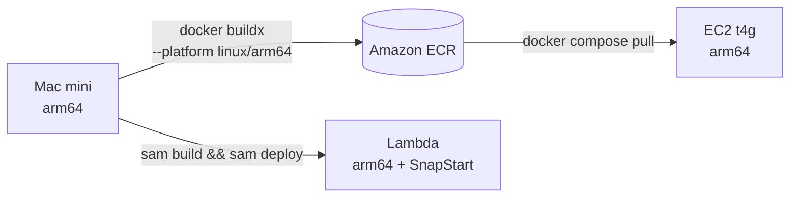
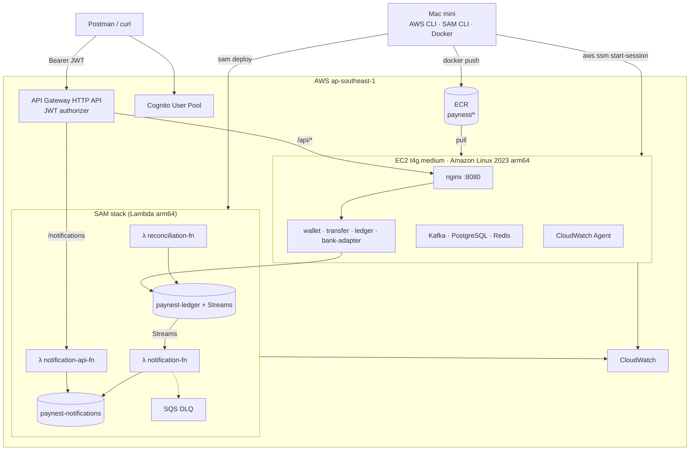

# 🍎 Deploy PayNest lên AWS từ Mac mini (Apple Silicon)

Phiên bản dành cho **Mac mini chip Apple Silicon (M1–M4)** của [`aws-setup.md`](aws-setup.md).

Kiến trúc, SAM template và code Java **giống hệt** bản Windows. File này chỉ ghi những gì **khác trên Mac**, cùng một thay đổi lớn: dùng **ARM64 xuyên suốt** — Mac build image một lần, chạy thẳng trên EC2 Graviton và Lambda arm64.

---

## Mục lục

0. [Chuẩn bị máy Mac](#0-chuẩn-bị-máy-mac)
1. [Vì sao dùng ARM64 xuyên suốt](#1-vì-sao-dùng-arm64-xuyên-suốt)
2. [Tài khoản AWS & AWS CLI](#2-tài-khoản-aws--aws-cli)
3. [Kiến trúc triển khai](#3-kiến-trúc-triển-khai)
4. [Bước 1 — EC2 Graviton & IAM](#4-bước-1--ec2-graviton--iam)
5. [Bước 2 — Build image trên Mac, đẩy lên ECR](#5-bước-2--build-image-trên-mac-đẩy-lên-ecr)
6. [Bước 3 — Serverless stack bằng SAM](#6-bước-3--serverless-stack-bằng-sam)
7. [Bước 4 — Cognito: tạo user & lấy token](#7-bước-4--cognito-tạo-user--lấy-token)
8. [Bước 5 — Chạy backend trên EC2](#8-bước-5--chạy-backend-trên-ec2)
9. [CloudWatch từ terminal Mac](#9-cloudwatch-từ-terminal-mac)
10. [Kiểm thử end-to-end](#10-kiểm-thử-end-to-end)
11. [Cập nhật & dọn dẹp](#11-cập-nhật--dọn-dẹp)
12. [Khác biệt so với bản Windows](#12-khác-biệt-so-với-bản-windows)
13. [Checklist](#13-checklist)
14. [Tài liệu chính thức](#14-tài-liệu-chính-thức)

---

## 0. Chuẩn bị máy Mac

### 0.1 Kiểm tra chip

```bash
uname -m
# arm64  → Apple Silicon, làm theo file này
# x86_64 → Mac Intel: đổi mọi "arm64" thành "x86_64", EC2 dùng t3 thay vì t4g
```

### 0.2 Cài Homebrew

```bash
/bin/bash -c "$(curl -fsSL https://raw.githubusercontent.com/Homebrew/install/HEAD/install.sh)"

# Apple Silicon: Homebrew nằm ở /opt/homebrew, thêm vào PATH
echo 'eval "$(/opt/homebrew/bin/brew shellenv)"' >> ~/.zprofile
eval "$(/opt/homebrew/bin/brew shellenv)"
brew --version
```

### 0.3 Cài công cụ

| Công cụ | Lệnh | Mục đích |
|---|---|---|
| JDK 21 | `brew install --cask temurin@21` | Build Java |
| Git | `brew install git` | Mã nguồn (macOS có sẵn bản cũ) |
| IntelliJ IDEA CE | `brew install --cask intellij-idea-ce` | IDE |
| Docker | `brew install --cask docker-desktop` *hoặc* `brew install --cask orbstack` | Container local, build image |
| AWS CLI v2 | `brew install awscli` | Làm việc với AWS |
| AWS SAM CLI | Bộ cài `.pkg` chính thức (dưới đây) | Deploy serverless |
| Session Manager plugin | `brew install --cask session-manager-plugin` | Vào EC2 không cần SSH |
| jq | `brew install jq` | Đọc JSON trong terminal |
| Postman | `brew install --cask postman` | Test API |
| DBeaver | `brew install --cask dbeaver-community` | Xem PostgreSQL |
| kubectl, kind | `brew install kubectl kind` | Kubernetes (tùy chọn) |

> Nếu một tên cask báo không tìm thấy, chạy `brew search <tên>` để lấy tên đúng.

**Docker Desktop hay OrbStack?** Cả hai đều chạy container arm64 native. OrbStack nhẹ RAM hơn, khởi động nhanh hơn — hợp với Mac mini 16GB. Chỉ cài **một** trong hai.

### 0.4 Cài AWS SAM CLI

AWS đã ngừng duy trì Homebrew tap `aws/tap/aws-sam-cli` từ 09/2023, nên dùng bộ cài `.pkg` chính thức (bản arm64):

```bash
curl -LO https://github.com/aws/aws-sam-cli/releases/latest/download/aws-sam-cli-macos-arm64.pkg
sudo installer -pkg aws-sam-cli-macos-arm64.pkg -target /
rm aws-sam-cli-macos-arm64.pkg
sam --version
```

> SAM CLI yêu cầu macOS 13 trở lên. Nếu trước đó đã cài SAM qua Homebrew hoặc pip, gỡ bản đó trước.

### 0.5 Cấp RAM cho Docker

Không có `.wslconfig` như Windows — chỉnh trực tiếp trong app:

- **Docker Desktop:** Settings → Resources → Memory: **8GB**, CPU: 4
- **OrbStack:** Settings → System → Memory limit: **8GB**

### 0.6 Kiểm tra

```bash
java -version          # openjdk 21...
docker run --rm hello-world
docker info --format '{{.Architecture}}'   # aarch64
aws --version
sam --version
session-manager-plugin --version
```

---

## 1. Vì sao dùng ARM64 xuyên suốt

| Lớp | Chọn | Lý do |
|---|---|---|
| Máy dev | Mac mini Apple Silicon (arm64) | Có sẵn |
| Docker image | `linux/arm64` | Build native trên Mac, **không giả lập** → nhanh |
| EC2 | **`t4g.medium`** (Graviton, arm64) | Chạy thẳng image build trên Mac; Graviton thường rẻ hơn t3 cùng cỡ |
| Lambda | `Architectures: [arm64]` | Rẻ hơn x86, SnapStart cho Java đã hỗ trợ ARM64 từ 07/2024 |



Lợi ích lớn nhất: **build ở Mac, EC2 chỉ việc pull và chạy**. Bản Windows phải build Maven + Docker ngay trên EC2, tốn CPU và RAM của máy chủ.

> Nếu bạn vẫn muốn EC2 x86 (`t3`), build bằng `--platform linux/amd64`. Docker trên Mac sẽ giả lập nên chậm hơn đáng kể, nhưng vẫn chạy được.

---

## 2. Tài khoản AWS & AWS CLI

Phần Free Tier, MFA, Budget giống [`aws-setup.md` mục 0](aws-setup.md#0-chuẩn-bị--kiểm-soát-chi-phí). Tóm tắt:

- Tài khoản tạo từ 15/07/2025: credit-based, Free plan hết hạn sau 6 tháng hoặc khi hết credit.
- Bật MFA, tạo IAM user riêng, tạo AWS Budget.
- Region `ap-southeast-1`.

Cấu hình CLI:

```bash
aws configure
# AWS Access Key ID:     <của IAM user>
# AWS Secret Access Key: <...>
# Default region name:   ap-southeast-1
# Default output format: json

aws sts get-caller-identity
```

Lưu sẵn biến dùng cho cả file:

```bash
cat >> ~/.zshrc <<'EOF'

# ---- PayNest ----
export AWS_REGION=ap-southeast-1
export AWS_ACCOUNT_ID=$(aws sts get-caller-identity --query Account --output text 2>/dev/null)
export ECR_REGISTRY="$AWS_ACCOUNT_ID.dkr.ecr.$AWS_REGION.amazonaws.com"
EOF
source ~/.zshrc
echo $ECR_REGISTRY
```

---

## 3. Kiến trúc triển khai



---

## 4. Bước 1 — EC2 Graviton & IAM

### 4.1 IAM Role `paynest-ec2-role`

Giống bản Windows, **thêm** một policy để EC2 kéo image từ ECR:

| Policy | Mục đích |
|---|---|
| `CloudWatchAgentServerPolicy` | Ghi metrics, log |
| `AmazonSSMManagedInstanceCore` | Session Manager |
| `AmazonEC2ContainerRegistryReadOnly` | **Mới:** pull image từ ECR |
| Inline `paynest-ledger-access` | ledger-service ghi DynamoDB (nội dung ở [`aws-setup.md` mục 3.1](aws-setup.md#31-iam-role-cho-ec2)) |

Tạo bằng CLI từ Mac:

```bash
cat > /tmp/ec2-trust.json <<'EOF'
{
  "Version": "2012-10-17",
  "Statement": [{
    "Effect": "Allow",
    "Principal": { "Service": "ec2.amazonaws.com" },
    "Action": "sts:AssumeRole"
  }]
}
EOF

aws iam create-role --role-name paynest-ec2-role \
  --assume-role-policy-document file:///tmp/ec2-trust.json

for p in CloudWatchAgentServerPolicy AmazonSSMManagedInstanceCore AmazonEC2ContainerRegistryReadOnly; do
  aws iam attach-role-policy --role-name paynest-ec2-role \
    --policy-arn arn:aws:iam::aws:policy/$p
done

cat > /tmp/ledger-policy.json <<EOF
{
  "Version": "2012-10-17",
  "Statement": [{
    "Effect": "Allow",
    "Action": ["dynamodb:PutItem","dynamodb:UpdateItem","dynamodb:ConditionCheckItem","dynamodb:GetItem","dynamodb:Query"],
    "Resource": [
      "arn:aws:dynamodb:$AWS_REGION:$AWS_ACCOUNT_ID:table/paynest-ledger",
      "arn:aws:dynamodb:$AWS_REGION:$AWS_ACCOUNT_ID:table/paynest-ledger/index/*"
    ]
  }]
}
EOF
aws iam put-role-policy --role-name paynest-ec2-role \
  --policy-name paynest-ledger-access --policy-document file:///tmp/ledger-policy.json

aws iam create-instance-profile --instance-profile-name paynest-ec2-role
aws iam add-role-to-instance-profile --instance-profile-name paynest-ec2-role \
  --role-name paynest-ec2-role
```

> `CloudWatchAgentServerPolicy` nằm dưới đường dẫn `arn:aws:iam::aws:policy/` như các policy còn lại. Nếu lệnh attach báo không tìm thấy, gắn policy đó qua Console.

### 4.2 Tạo EC2 (Console)

| Mục | Giá trị |
|---|---|
| AMI | **Amazon Linux 2023 — chọn kiến trúc 64-bit (Arm)** |
| Instance type | **`t4g.medium`** (2 vCPU, 4GB). Thiếu RAM → `t4g.large` |
| Key pair | Tạo mới, tải `paynest-key.pem` |
| Storage | 30GB gp3 |
| IAM instance profile | `paynest-ec2-role` |
| Security Group | 22 ← My IP · 8080 ← `0.0.0.0/0` (lý do ở [`aws-setup.md` mục 3.2](aws-setup.md#32-tạo-ec2)) |

> Xem giá theo giờ của `t4g` tại trang EC2 Pricing trước khi launch.

### 4.3 Kết nối từ Mac

**Cách 1 — SSH:**

```bash
mkdir -p ~/.ssh
mv ~/Downloads/paynest-key.pem ~/.ssh/
chmod 400 ~/.ssh/paynest-key.pem      # bắt buộc, nếu không SSH từ chối key

cat >> ~/.ssh/config <<'EOF'

Host paynest
  HostName <EC2_PUBLIC_DNS>
  User ec2-user
  IdentityFile ~/.ssh/paynest-key.pem
EOF

ssh paynest
```

**Cách 2 — Session Manager (không cần port 22, không cần key):**

```bash
INSTANCE_ID=$(aws ec2 describe-instances \
  --filters "Name=tag:Name,Values=paynest-dev" "Name=instance-state-name,Values=running" \
  --query "Reservations[0].Instances[0].InstanceId" --output text)

aws ssm start-session --target $INSTANCE_ID
```

### 4.4 Cài Docker trên EC2

Giống bản Windows. Lệnh tải Compose dùng `$(uname -m)` nên tự lấy bản `aarch64`:

```bash
sudo dnf update -y
sudo dnf install -y docker
sudo systemctl enable --now docker
sudo usermod -aG docker ec2-user
# thoát ra rồi vào lại

sudo mkdir -p /usr/local/lib/docker/cli-plugins
sudo curl -SL "https://github.com/docker/compose/releases/latest/download/docker-compose-linux-$(uname -m)" \
  -o /usr/local/lib/docker/cli-plugins/docker-compose
sudo chmod +x /usr/local/lib/docker/cli-plugins/docker-compose
docker compose version
```

Không cần cài Git, JDK, Maven trên EC2 — image đã build sẵn trên Mac.

---

## 5. Bước 2 — Build image trên Mac, đẩy lên ECR

### 5.1 Tạo repository

```bash
for svc in wallet-service transfer-service ledger-service bank-adapter; do
  aws ecr create-repository --repository-name paynest/$svc \
    --image-scanning-configuration scanOnPush=true >/dev/null
done

# Chỉ giữ 10 image gần nhất mỗi repo để không tốn dung lượng
cat > /tmp/ecr-lifecycle.json <<'EOF'
{"rules":[{"rulePriority":1,"description":"keep last 10",
  "selection":{"tagStatus":"any","countType":"imageCountMoreThan","countNumber":10},
  "action":{"type":"expire"}}]}
EOF
for svc in wallet-service transfer-service ledger-service bank-adapter; do
  aws ecr put-lifecycle-policy --repository-name paynest/$svc \
    --lifecycle-policy-text file:///tmp/ecr-lifecycle.json >/dev/null
done
```

### 5.2 Script build & push: `scripts/push-images.sh`

```bash
#!/usr/bin/env zsh
set -euo pipefail

TAG=${1:-$(git rev-parse --short HEAD)}
SERVICES=(wallet-service transfer-service ledger-service bank-adapter)

aws ecr get-login-password --region "$AWS_REGION" \
  | docker login --username AWS --password-stdin "$ECR_REGISTRY"

./mvnw -q -DskipTests package

for svc in $SERVICES; do
  echo "▶ $svc:$TAG"
  docker buildx build \
    --platform linux/arm64 \
    -t "$ECR_REGISTRY/paynest/$svc:$TAG" \
    -t "$ECR_REGISTRY/paynest/$svc:latest" \
    --push \
    "services/$svc"
done

echo "✅ Đã push tag $TAG"
```

```bash
chmod +x scripts/push-images.sh
./scripts/push-images.sh
```

Dockerfile giữ nguyên như bản Windows — `eclipse-temurin:21-jre` là image đa kiến trúc, Docker tự chọn bản arm64.

---

## 6. Bước 3 — Serverless stack bằng SAM

### 6.1 Template

Dùng nguyên `infra/sam/template.yaml` trong [`aws-setup.md` mục 4.1](aws-setup.md#41-infrasamtemplateyaml), **chỉ đổi 1 dòng** trong `Globals`:

```diff
 Globals:
   Function:
     Runtime: java21
-    Architectures: [x86_64]
+    Architectures: [arm64]
     MemorySize: 1024
```

Code Java của Lambda không cần sửa: file `.jar` chạy được trên mọi kiến trúc.

### 6.2 Verify email cho SES

```bash
aws sesv2 create-email-identity --email-identity you@gmail.com
# Mở hộp thư, bấm link xác nhận
```

### 6.3 Build & deploy

```bash
cd infra/sam
sam build
sam deploy --guided
```

| Câu hỏi | Trả lời |
|---|---|
| Stack Name | `paynest-serverless` |
| AWS Region | `ap-southeast-1` |
| BackendUrl | `http://<EC2_PUBLIC_DNS>:8080` |
| SenderEmail | email đã verify |
| Allow SAM CLI IAM role creation | `Y` |
| Save arguments to samconfig.toml | `Y` |

> `sam build` cho Java chỉ cần JDK + Maven trên Mac. Chỉ `sam local invoke` / `sam local start-api` mới cần Docker — và trên Mac Apple Silicon chúng chạy image Lambda arm64 native.

### 6.4 Lưu Outputs vào biến môi trường

```bash
STACK=paynest-serverless
out() {
  aws cloudformation describe-stacks --stack-name $STACK \
    --query "Stacks[0].Outputs[?OutputKey=='$1'].OutputValue" --output text
}

cat > ~/.paynest.env <<EOF
export API=$(out ApiUrl)
export POOL_ID=$(out UserPoolId)
export CLIENT_ID=$(out UserPoolClientId)
export COGNITO_ISSUER=$(out CognitoIssuer)
EOF

source ~/.paynest.env
echo "API=$API"
```

---

## 7. Bước 4 — Cognito: tạo user & lấy token

```bash
source ~/.paynest.env

# Tạo 2 user để thử chuyển tiền
for u in alice bob; do
  aws cognito-idp sign-up --client-id $CLIENT_ID \
    --username $u@example.com --password "Passw0rd${(C)u}1" >/dev/null
  aws cognito-idp admin-confirm-sign-up --user-pool-id $POOL_ID --username $u@example.com
done

# Hàm lấy access token
token() {
  local name=$1
  aws cognito-idp initiate-auth --client-id $CLIENT_ID \
    --auth-flow USER_PASSWORD_AUTH \
    --auth-parameters USERNAME=$name@example.com,PASSWORD="Passw0rd${(C)name}1" \
    --query "AuthenticationResult.AccessToken" --output text
}

ALICE=$(token alice)
BOB=$(token bob)
```

> `${(C)u}` là cú pháp zsh viết hoa chữ cái đầu → mật khẩu `Passw0rdAlice1`, `Passw0rdBob1`. Access token hết hạn sau 60 phút — chạy lại `token` để lấy mới.

Xem nội dung token ngay trong terminal:

```bash
echo $ALICE | cut -d. -f2 | tr '_-' '/+' | base64 -D 2>/dev/null | jq .
# Nếu báo lỗi do thiếu padding, dán token vào https://jwt.io
```

---

## 8. Bước 5 — Chạy backend trên EC2

### 8.1 Code Spring Boot

Toàn bộ thay đổi code (Resource Server, `jwt.getSubject()`, ledger DynamoDB, profile `aws`, Micrometer) **giống** [`aws-setup.md` mục 6](aws-setup.md#6-thay-đổi-code-spring-boot). Code 3 Lambda **giống** [mục 7](aws-setup.md#7-code-lambda).

### 8.2 `infra/docker-compose.aws.yml` — dùng image từ ECR

Khác bản Windows: dùng `image:` thay vì `build:`.

```yaml
x-aws-logging: &aws-logging
  driver: awslogs
  options:
    awslogs-region: ap-southeast-1
    awslogs-group: /paynest/app
    awslogs-create-group: "true"
    tag: "{{.Name}}"

x-spring-env: &spring-env
  SPRING_PROFILES_ACTIVE: aws
  KAFKA_BOOTSTRAP: kafka:9092
  COGNITO_USER_POOL_ID: ${COGNITO_USER_POOL_ID}
  COGNITO_CLIENT_ID: ${COGNITO_CLIENT_ID}

services:
  nginx:
    image: nginx:alpine
    ports: ["8080:8080"]
    volumes: ["./nginx.conf:/etc/nginx/conf.d/default.conf:ro"]
    logging: *aws-logging

  wallet-service:
    image: ${ECR_REGISTRY}/paynest/wallet-service:${TAG:-latest}
    logging: *aws-logging
    environment: { <<: *spring-env, DB_HOST: wallet-db }
    mem_limit: 640m

  transfer-service:
    image: ${ECR_REGISTRY}/paynest/transfer-service:${TAG:-latest}
    logging: *aws-logging
    environment: { <<: *spring-env, DB_HOST: transfer-db }
    mem_limit: 640m

  ledger-service:
    image: ${ECR_REGISTRY}/paynest/ledger-service:${TAG:-latest}
    logging: *aws-logging
    environment: { <<: *spring-env }
    mem_limit: 512m

  bank-adapter:
    image: ${ECR_REGISTRY}/paynest/bank-adapter:${TAG:-latest}
    logging: *aws-logging
    environment: { <<: *spring-env }
    mem_limit: 384m

  kafka:
    mem_limit: 1g
```

`nginx.conf` giống bản Windows. Kafka, PostgreSQL, Redis, nginx đều có image đa kiến trúc, chạy được trên Graviton.

### 8.3 Đưa file cấu hình lên EC2 và chạy

Từ Mac:

```bash
ssh paynest 'mkdir -p ~/paynest/infra'
scp infra/docker-compose.yml infra/docker-compose.aws.yml infra/nginx.conf paynest:~/paynest/infra/

# Tạo file .env trên EC2 (Compose tự đọc file này)
ssh paynest "cat > ~/paynest/infra/.env" <<EOF
ECR_REGISTRY=$ECR_REGISTRY
COGNITO_USER_POOL_ID=$POOL_ID
COGNITO_CLIENT_ID=$CLIENT_ID
TAG=latest
EOF
```

Trên EC2:

```bash
cd ~/paynest/infra
aws ecr get-login-password --region ap-southeast-1 \
  | docker login --username AWS --password-stdin $(grep ECR_REGISTRY .env | cut -d= -f2)

docker compose -f docker-compose.yml -f docker-compose.aws.yml pull
docker compose -f docker-compose.yml -f docker-compose.aws.yml up -d
docker compose ps
```

> AWS CLI có sẵn trên Amazon Linux 2023 và tự dùng IAM Role để đăng nhập ECR — không cần access key trên EC2.

---

## 9. CloudWatch từ terminal Mac

### 9.1 CloudWatch Agent

Cài trên EC2 giống hệt [`aws-setup.md` mục 8.1](aws-setup.md#81-cloudwatch-agent-trên-ec2-ram-disk) — gói `amazon-cloudwatch-agent` trong `dnf` có bản arm64.

### 9.2 Xem log trực tiếp trên Mac

```bash
# Log Spring Boot, chỉ dòng ERROR, theo thời gian thực
aws logs tail /paynest/app --follow --filter-pattern ERROR

# Log của 1 container
aws logs tail /paynest/app --follow --log-stream-name-prefix transfer-service

# Log Lambda
sam logs --stack-name paynest-serverless --name NotificationFunction --tail

# Access log API Gateway, 10 phút gần nhất
aws logs tail /paynest/apigw --since 10m --format short
```

### 9.3 Thông báo alarm

```bash
TOPIC=$(aws sns create-topic --name paynest-alerts --query TopicArn --output text)
aws sns subscribe --topic-arn $TOPIC --protocol email --notification-endpoint you@gmail.com
```

Tạo nhanh các alarm quan trọng:

```bash
alarm() {   # tên  namespace  metric  dimension  ngưỡng
  aws cloudwatch put-metric-alarm --alarm-name "$1" \
    --namespace "$2" --metric-name "$3" --dimensions "$4" \
    --statistic Maximum --period 300 --evaluation-periods 1 \
    --threshold "$5" --comparison-operator GreaterThanThreshold \
    --treat-missing-data notBreaching --alarm-actions $TOPIC
}

alarm paynest-dlq-not-empty  AWS/SQS     ApproximateNumberOfMessagesVisible Name=QueueName,Value=paynest-notification-dlq 0
alarm paynest-stream-lag     AWS/Lambda  IteratorAge                         Name=FunctionName,Value=paynest-notification-fn 60000
alarm paynest-lambda-errors  AWS/Lambda  Errors                              Name=FunctionName,Value=paynest-notification-fn 0

# UnbalancedTransfers được Lambda gửi KHÔNG có dimension → gọi thẳng, bỏ --dimensions
aws cloudwatch put-metric-alarm --alarm-name paynest-ledger-unbalanced \
  --namespace PayNest/Reconciliation --metric-name UnbalancedTransfers \
  --statistic Maximum --period 86400 --evaluation-periods 1 \
  --threshold 0 --comparison-operator GreaterThanThreshold \
  --treat-missing-data notBreaching --alarm-actions $TOPIC
```

Danh sách đầy đủ alarm, metric filter, Logs Insights và dashboard: [`aws-setup.md` mục 8](aws-setup.md#8-cloudwatch).

---

## 10. Kiểm thử end-to-end

```bash
source ~/.paynest.env

# 1. Không token → 401 từ API Gateway
curl -i "$API/api/wallets/me"

# 2. Tạo ví cho cả hai (lazy) và lấy walletId của Bob
curl -s -H "Authorization: Bearer $ALICE" "$API/api/wallets/me" | jq
BOB_WALLET=$(curl -s -H "Authorization: Bearer $BOB" "$API/api/wallets/me" | jq -r .id)

# 3. Alice chuyển cho Bob
KEY=$(uuidgen)
curl -s -X POST "$API/api/transfers" \
  -H "Authorization: Bearer $ALICE" \
  -H "Idempotency-Key: $KEY" \
  -H "Content-Type: application/json" \
  -d "{\"toWalletId\":\"$BOB_WALLET\",\"amount\":100000}" | jq

# 4. Gửi lại đúng request đó → phải trả về giao dịch cũ, không trừ tiền lần 2
curl -s -X POST "$API/api/transfers" \
  -H "Authorization: Bearer $ALICE" \
  -H "Idempotency-Key: $KEY" \
  -H "Content-Type: application/json" \
  -d "{\"toWalletId\":\"$BOB_WALLET\",\"amount\":100000}" | jq

# 5. Thông báo của Bob (đi thẳng tới Lambda)
sleep 3
curl -s -H "Authorization: Bearer $BOB" "$API/notifications" | jq

# 6. Thử throttling: 200 request song song → sẽ có 429
seq 200 | xargs -P 50 -I{} curl -s -o /dev/null -w "%{http_code}\n" \
  -H "Authorization: Bearer $ALICE" "$API/api/wallets/me" | sort | uniq -c

# 7. Chạy đối soát ngay
aws lambda invoke --function-name paynest-reconciliation-fn:live /tmp/out.json && cat /tmp/out.json
```

Các kịch bản lỗi nên thử: xem bảng trong [`aws-setup.md` mục 9](aws-setup.md#9-kiểm-thử-end-to-end).

---

## 11. Cập nhật & dọn dẹp

### Cập nhật

```bash
# Backend: build trên Mac → push → EC2 pull
./scripts/push-images.sh
ssh paynest 'cd ~/paynest/infra && \
  aws ecr get-login-password --region ap-southeast-1 | docker login --username AWS --password-stdin $(grep ECR_REGISTRY .env | cut -d= -f2) && \
  docker compose -f docker-compose.yml -f docker-compose.aws.yml pull && \
  docker compose -f docker-compose.yml -f docker-compose.aws.yml up -d'

# Serverless
cd infra/sam && sam build && sam deploy
```

Public IP của EC2 đổi sau mỗi lần stop/start → cập nhật `~/.ssh/config` và chạy lại `sam deploy --parameter-overrides BackendUrl=http://<DNS_MỚI>:8080`. Muốn tránh, gắn Elastic IP.

### Stop / start EC2 nhanh

```bash
aws ec2 stop-instances  --instance-ids $INSTANCE_ID
aws ec2 start-instances --instance-ids $INSTANCE_ID
```

### Dọn dẹp khi học xong

```bash
sam delete --stack-name paynest-serverless
aws ec2 terminate-instances --instance-ids $INSTANCE_ID
for svc in wallet-service transfer-service ledger-service bank-adapter; do
  aws ecr delete-repository --repository-name paynest/$svc --force
done
aws logs delete-log-group --log-group-name /paynest/app
aws sns delete-topic --topic-arn $TOPIC
aws sesv2 delete-email-identity --email-identity you@gmail.com
```

Kiểm tra lại trong Console: EBS volume, snapshot, Elastic IP còn sót.

---

## 12. Khác biệt so với bản Windows

| Mục | Windows (`aws-setup.md`) | Mac mini (file này) |
|---|---|---|
| Cài công cụ | `winget` | Homebrew + `.pkg` cho SAM CLI |
| Shell | PowerShell | zsh |
| RAM cho Docker | `.wslconfig` | Settings của Docker Desktop / OrbStack |
| EC2 | `t3.medium` (x86_64) | **`t4g.medium` (arm64, Graviton)** |
| Lambda | `x86_64` | **`arm64`** |
| Build image | Trên EC2 (`--build`) | **Trên Mac, đẩy lên ECR** |
| IAM role EC2 | 3 policy | + `AmazonEC2ContainerRegistryReadOnly` |
| Compose AWS | `build:` | `image: ${ECR_REGISTRY}/...` |
| Xem log | Console | `aws logs tail --follow` ngay trên terminal |
| Key SSH | `.pem` bất kỳ | `chmod 400` + `~/.ssh/config` |

---

## 13. Checklist

**Mac**
- [ ] `uname -m` = `arm64`
- [ ] Homebrew, JDK 21, Docker Desktop hoặc OrbStack (8GB RAM)
- [ ] AWS CLI, SAM CLI (.pkg arm64), Session Manager plugin, jq
- [ ] `aws configure`, biến `ECR_REGISTRY` trong `~/.zshrc`

**AWS**
- [ ] Role `paynest-ec2-role` có thêm `AmazonEC2ContainerRegistryReadOnly`
- [ ] EC2 `t4g.medium`, AMI Amazon Linux 2023 **Arm**
- [ ] SSH bằng `ssh paynest` hoặc `aws ssm start-session`
- [ ] 4 ECR repository + lifecycle policy
- [ ] `./scripts/push-images.sh` thành công
- [ ] SAM template đổi `Architectures: [arm64]`, `sam deploy` xong
- [ ] `~/.paynest.env` có `API`, `POOL_ID`, `CLIENT_ID`
- [ ] Token của Alice và Bob lấy được

**Chạy & giám sát**
- [ ] EC2 `docker compose pull && up -d` chạy đủ service
- [ ] Gọi API không token → 401; có token → 200
- [ ] Chuyển tiền → Bob có thông báo
- [ ] `aws logs tail /paynest/app --follow` thấy log
- [ ] Alarm DLQ, IteratorAge, Lambda Errors, UnbalancedTransfers

---

## 14. Tài liệu chính thức

**Công cụ trên Mac**
- Homebrew — https://brew.sh/
- Cài AWS CLI — https://docs.aws.amazon.com/cli/latest/userguide/getting-started-install.html
- Cài AWS SAM CLI — https://docs.aws.amazon.com/serverless-application-model/latest/developerguide/install-sam-cli.html
- Session Manager plugin — https://docs.aws.amazon.com/systems-manager/latest/userguide/session-manager-working-with-install-plugin.html
- Docker Buildx multi-platform — https://docs.docker.com/build/building/multi-platform/

**ARM64 / Graviton**
- Lambda SnapStart hỗ trợ ARM64 (07/2024) — https://aws.amazon.com/about-aws/whats-new/2024/07/aws-lambda-snapstart-java-functions-arm64-architecture/
- Lambda instruction set architectures — https://docs.aws.amazon.com/lambda/latest/dg/foundation-arch.html
- AWS Graviton — https://aws.amazon.com/ec2/graviton/

**ECR**
- Amazon ECR User Guide — https://docs.aws.amazon.com/AmazonECR/latest/userguide/what-is-ecr.html
- ECR lifecycle policies — https://docs.aws.amazon.com/AmazonECR/latest/userguide/LifecyclePolicies.html

**CloudWatch**
- `aws logs tail` — https://docs.aws.amazon.com/cli/latest/reference/logs/tail.html

Các tài liệu về Cognito, API Gateway, Lambda, DynamoDB, CloudWatch, Spring: xem [`aws-setup.md` mục 12](aws-setup.md#12-tài-liệu-chính-thức).
