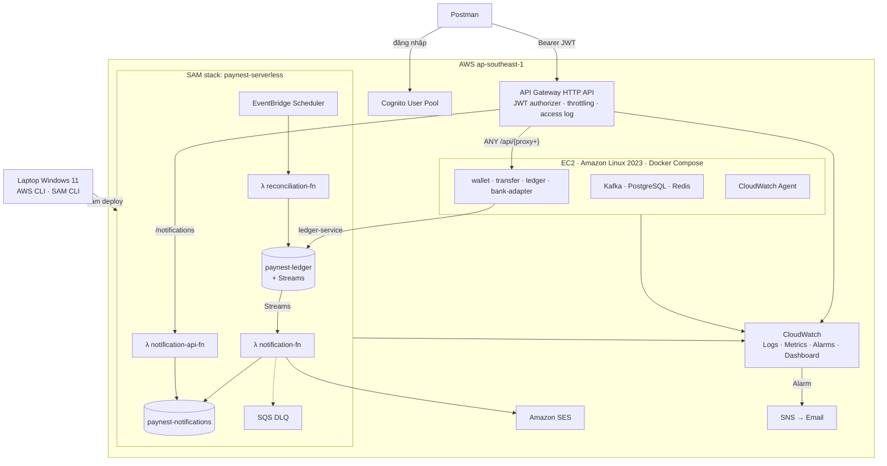
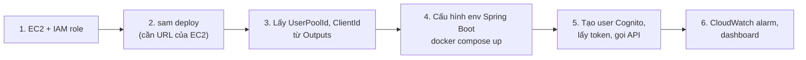

# ☁️ Deploy PayNest lên AWS: EC2 + Serverless + CloudWatch

Hướng dẫn triển khai kiến trúc **hybrid** của dự án:

- **EC2** chạy các service Spring Boot (wallet, transfer, ledger, bank-adapter) + Kafka, PostgreSQL, Redis bằng Docker Compose.
- **Serverless** (triển khai bằng AWS SAM): Cognito, API Gateway (HTTP API), Lambda, DynamoDB, SQS, EventBridge Scheduler, SES.
- **CloudWatch** giám sát toàn bộ: log, metrics, alarm, dashboard.

Kèm theo **toàn bộ thay đổi code** cần làm.

---

## Mục lục

0. [Chuẩn bị & kiểm soát chi phí](#0-chuẩn-bị--kiểm-soát-chi-phí)
1. [Kiến trúc triển khai](#1-kiến-trúc-triển-khai)
2. [Thứ tự triển khai](#2-thứ-tự-triển-khai)
3. [Bước 1 — EC2 & IAM](#3-bước-1--ec2--iam)
4. [Bước 2 — Serverless stack bằng SAM](#4-bước-2--serverless-stack-bằng-sam)
5. [Bước 3 — Cognito: tạo user & lấy token](#5-bước-3--cognito-tạo-user--lấy-token)
6. [Thay đổi code: Spring Boot](#6-thay-đổi-code-spring-boot)
7. [Code Lambda](#7-code-lambda)
8. [CloudWatch](#8-cloudwatch)
9. [Kiểm thử end-to-end](#9-kiểm-thử-end-to-end)
10. [Cập nhật & dọn dẹp](#10-cập-nhật--dọn-dẹp)
11. [Checklist](#11-checklist)
12. [Tài liệu chính thức](#12-tài-liệu-chính-thức)

---

## 0. Chuẩn bị & kiểm soát chi phí

### ⚠️ Free Tier đã thay đổi

Tài khoản AWS tạo **từ 15/07/2025** dùng mô hình **credit**:

- Nhận **$100 credit** khi đăng ký, kiếm thêm tối đa **$100** khi hoàn thành các hoạt động onboarding.
- **Free plan** hết hạn sau **6 tháng hoặc khi hết credit**, tùy cái nào đến trước.
- EC2, Lambda, DynamoDB... dùng tới đâu **trừ vào credit** tới đó.

Tài khoản tạo trước ngày đó giữ mô hình cũ. Kiểm tra tại **Billing → Free Tier**.

### Việc làm ngay khi có tài khoản

1. Bật **MFA** cho root user, tạo IAM user riêng để làm việc hằng ngày.
2. Tạo **AWS Budget** (vd $10/tháng), cảnh báo email ở 50% / 80% / 100%.
3. Region: **`ap-southeast-1` (Singapore)**.
4. **Stop EC2 khi không dùng.** Phần serverless gần như không tốn gì khi không có request, nhưng EC2 thì tính theo giờ chạy.

### Công cụ cần cài thêm trên Windows

```powershell
winget install Amazon.AWSCLI
winget install Amazon.SAM-CLI
```

```powershell
aws configure          # nhập access key của IAM user, region ap-southeast-1, output json
aws sts get-caller-identity
sam --version
```

> Nếu ID winget báo không tìm thấy, chạy `winget search aws` / `winget search sam` để lấy ID đúng.

---

## 1. Kiến trúc triển khai



| Nguồn dữ liệu giám sát | Cách gửi | Đích |
|---|---|---|
| Log container Spring Boot | Docker `awslogs` driver | Log group `/paynest/app` |
| Log Lambda | Tự động (JSON) | `/aws/lambda/<tên hàm>` |
| Access log API Gateway | Stage access log | `/paynest/apigw` |
| CPU, network EC2 | Có sẵn | `AWS/EC2` |
| RAM, disk EC2 | CloudWatch Agent | `CWAgent` |
| Metrics JVM & nghiệp vụ | Micrometer | `PayNest` |
| Lambda, API GW, DynamoDB, SQS | Có sẵn | `AWS/Lambda`, `AWS/ApiGateway`, `AWS/DynamoDB`, `AWS/SQS` |
| Kết quả đối soát | `PutMetricData` từ Lambda | `PayNest/Reconciliation` |

---

## 2. Thứ tự triển khai



Lý do: API Gateway cần biết địa chỉ EC2 để chuyển tiếp, còn Spring Boot cần biết UserPool để kiểm tra JWT.

---

## 3. Bước 1 — EC2 & IAM

### 3.1 IAM Role cho EC2

**IAM → Roles → Create role → AWS service → EC2**, gắn:

| Policy | Mục đích |
|---|---|
| `CloudWatchAgentServerPolicy` | Ghi metrics, log lên CloudWatch |
| `AmazonSSMManagedInstanceCore` | Kết nối bằng Session Manager, không cần mở port 22 |
| Inline policy `paynest-ledger-access` (dưới đây) | ledger-service ghi DynamoDB |

```json
{
  "Version": "2012-10-17",
  "Statement": [
    {
      "Effect": "Allow",
      "Action": [
        "dynamodb:PutItem",
        "dynamodb:UpdateItem",
        "dynamodb:ConditionCheckItem",
        "dynamodb:GetItem",
        "dynamodb:Query"
      ],
      "Resource": [
        "arn:aws:dynamodb:ap-southeast-1:<ACCOUNT_ID>:table/paynest-ledger",
        "arn:aws:dynamodb:ap-southeast-1:<ACCOUNT_ID>:table/paynest-ledger/index/*"
      ]
    }
  ]
}
```

> `TransactWriteItems` không phải một quyền IAM riêng: nó cần các quyền của từng thao tác bên trong (`PutItem`, `ConditionCheckItem`...).

Tên role: `paynest-ec2-role`. **Không bao giờ** copy access key vào máy EC2.

### 3.2 Tạo EC2

| Mục | Giá trị |
|---|---|
| AMI | **Amazon Linux 2023** |
| Instance type | **`t3.medium`** (4GB) — nhẹ hơn bản trước vì đã bỏ MongoDB, notification-service, user-service, gateway. Lên `t3.large` nếu thiếu RAM |
| Storage | 30GB gp3 |
| IAM instance profile | `paynest-ec2-role` |

> Xem giá chính xác trên trang EC2 Pricing cho region trước khi launch.

**Security Group:**

| Port | Source | Lý do |
|---|---|---|
| 22 | My IP | SSH (bỏ nếu dùng Session Manager) |
| 8080 | `0.0.0.0/0` | API Gateway không có IP cố định nên phải mở. **An toàn vì Spring Boot vẫn tự kiểm tra JWT** (mục 6.2) |

❌ Không mở 9092 (Kafka), 5432 (PostgreSQL), 6379 (Redis).

> **Cách làm production:** đặt EC2/ECS trong private subnet, API Gateway nối vào qua **VPC Link + ALB/NLB nội bộ**, không mở 8080 ra Internet. Bản học tập bỏ qua để tiết kiệm chi phí load balancer.

Ghi lại **Public IPv4 DNS** của instance, ví dụ `ec2-13-212-xx-xx.ap-southeast-1.compute.amazonaws.com`.

> Public IP đổi mỗi lần stop/start. Muốn cố định thì gắn Elastic IP (nhớ release khi xong), hoặc chạy lại `sam deploy` với URL mới.

### 3.3 Cài Docker

```bash
sudo dnf update -y
sudo dnf install -y docker git
sudo systemctl enable --now docker
sudo usermod -aG docker ec2-user
# thoát ra rồi SSH lại

sudo mkdir -p /usr/local/lib/docker/cli-plugins
sudo curl -SL "https://github.com/docker/compose/releases/latest/download/docker-compose-linux-$(uname -m)" \
  -o /usr/local/lib/docker/cli-plugins/docker-compose
sudo chmod +x /usr/local/lib/docker/cli-plugins/docker-compose
docker compose version
```

Chưa chạy `docker compose up` ở bước này — cần thông tin Cognito từ bước 2.

---

## 4. Bước 2 — Serverless stack bằng SAM

### 4.1 `infra/sam/template.yaml`

```yaml
AWSTemplateFormatVersion: '2010-09-09'
Transform: AWS::Serverless-2016-10-31
Description: PayNest serverless stack (Cognito, API Gateway, Lambda, DynamoDB)

Parameters:
  BackendUrl:
    Type: String
    Description: "Vd http://ec2-13-212-xx-xx.ap-southeast-1.compute.amazonaws.com:8080"
  SenderEmail:
    Type: String
    Description: Email gửi thông báo (đã verify trong SES)

Globals:
  Function:
    Runtime: java21
    Architectures: [x86_64]
    MemorySize: 1024
    Timeout: 30
    AutoPublishAlias: live
    SnapStart:
      ApplyOn: PublishedVersions
    LoggingConfig:
      LogFormat: JSON
      ApplicationLogLevel: INFO

Resources:

  # ───────────── Cognito ─────────────
  UserPool:
    Type: AWS::Cognito::UserPool
    Properties:
      UserPoolName: paynest-users
      UsernameAttributes: [email]
      AutoVerifiedAttributes: [email]
      Policies:
        PasswordPolicy:
          MinimumLength: 10
          RequireUppercase: true
          RequireLowercase: true
          RequireNumbers: true
          RequireSymbols: false

  UserPoolClient:
    Type: AWS::Cognito::UserPoolClient
    Properties:
      UserPoolId: !Ref UserPool
      ClientName: paynest-app
      GenerateSecret: false
      ExplicitAuthFlows:
        - ALLOW_USER_PASSWORD_AUTH
        - ALLOW_REFRESH_TOKEN_AUTH
      AccessTokenValidity: 60
      TokenValidityUnits:
        AccessToken: minutes

  # ───────────── DynamoDB ─────────────
  LedgerTable:
    Type: AWS::DynamoDB::Table
    Properties:
      TableName: paynest-ledger
      BillingMode: PAY_PER_REQUEST
      AttributeDefinitions:
        - { AttributeName: PK,     AttributeType: S }
        - { AttributeName: SK,     AttributeType: S }
        - { AttributeName: GSI1PK, AttributeType: S }
        - { AttributeName: GSI1SK, AttributeType: S }
      KeySchema:
        - { AttributeName: PK, KeyType: HASH }
        - { AttributeName: SK, KeyType: RANGE }
      GlobalSecondaryIndexes:
        - IndexName: GSI1
          KeySchema:
            - { AttributeName: GSI1PK, KeyType: HASH }
            - { AttributeName: GSI1SK, KeyType: RANGE }
          Projection: { ProjectionType: ALL }
      StreamSpecification:
        StreamViewType: NEW_IMAGE
      PointInTimeRecoverySpecification:
        PointInTimeRecoveryEnabled: true

  NotificationTable:
    Type: AWS::DynamoDB::Table
    Properties:
      TableName: paynest-notifications
      BillingMode: PAY_PER_REQUEST
      AttributeDefinitions:
        - { AttributeName: PK, AttributeType: S }
        - { AttributeName: SK, AttributeType: S }
      KeySchema:
        - { AttributeName: PK, KeyType: HASH }
        - { AttributeName: SK, KeyType: RANGE }
      TimeToLiveSpecification:
        AttributeName: expiresAt
        Enabled: true

  NotificationDLQ:
    Type: AWS::SQS::Queue
    Properties:
      QueueName: paynest-notification-dlq
      MessageRetentionPeriod: 1209600   # 14 ngày

  # ───────────── Lambda ─────────────
  NotificationFunction:
    Type: AWS::Serverless::Function
    Properties:
      FunctionName: paynest-notification-fn
      CodeUri: ../../functions/notification-fn
      Handler: com.paynest.notification.StreamHandler::handleRequest
      Environment:
        Variables:
          NOTIFICATION_TABLE: !Ref NotificationTable
          SENDER_EMAIL: !Ref SenderEmail
      Policies:
        - DynamoDBCrudPolicy: { TableName: !Ref NotificationTable }
        - SESCrudPolicy: { IdentityName: !Ref SenderEmail }
        - SQSSendMessagePolicy: { QueueName: !GetAtt NotificationDLQ.QueueName }
      Events:
        LedgerStream:
          Type: DynamoDB
          Properties:
            Stream: !GetAtt LedgerTable.StreamArn
            StartingPosition: TRIM_HORIZON
            BatchSize: 50
            MaximumRetryAttempts: 3
            BisectBatchOnFunctionError: true
            FunctionResponseTypes: [ReportBatchItemFailures]
            DestinationConfig:
              OnFailure:
                Type: SQS
                Destination: !GetAtt NotificationDLQ.Arn
            FilterCriteria:
              Filters:
                - Pattern: '{"eventName": ["INSERT"], "dynamodb": {"NewImage": {"type": {"S": ["TRANSFER"]}}}}'

  NotificationApiFunction:
    Type: AWS::Serverless::Function
    Properties:
      FunctionName: paynest-notification-api-fn
      CodeUri: ../../functions/notification-fn
      Handler: com.paynest.notification.ApiHandler::handleRequest
      Environment:
        Variables:
          NOTIFICATION_TABLE: !Ref NotificationTable
      Policies:
        - DynamoDBCrudPolicy: { TableName: !Ref NotificationTable }

  ReconciliationFunction:
    Type: AWS::Serverless::Function
    Properties:
      FunctionName: paynest-reconciliation-fn
      CodeUri: ../../functions/reconciliation-fn
      Handler: com.paynest.reconciliation.ReconciliationHandler::handleRequest
      Timeout: 300
      Environment:
        Variables:
          LEDGER_TABLE: !Ref LedgerTable
      Policies:
        - DynamoDBReadPolicy: { TableName: !Ref LedgerTable }
        - CloudWatchPutMetricPolicy: {}
      Events:
        Nightly:
          Type: ScheduleV2
          Properties:
            ScheduleExpression: cron(0 0 * * ? *)
            ScheduleExpressionTimezone: Asia/Ho_Chi_Minh

  # ───────────── API Gateway (HTTP API) ─────────────
  HttpApi:
    Type: AWS::ApiGatewayV2::Api
    Properties:
      Name: paynest-api
      ProtocolType: HTTP
      CorsConfiguration:
        AllowOrigins: ['*']
        AllowMethods: [GET, POST, PATCH, PUT, DELETE, OPTIONS]
        AllowHeaders: [Authorization, Content-Type, Idempotency-Key]

  JwtAuthorizer:
    Type: AWS::ApiGatewayV2::Authorizer
    Properties:
      ApiId: !Ref HttpApi
      Name: cognito-jwt
      AuthorizerType: JWT
      IdentitySource: ['$request.header.Authorization']
      JwtConfiguration:
        Audience: [!Ref UserPoolClient]
        Issuer: !Sub https://cognito-idp.${AWS::Region}.amazonaws.com/${UserPool}

  BackendIntegration:
    Type: AWS::ApiGatewayV2::Integration
    Properties:
      ApiId: !Ref HttpApi
      IntegrationType: HTTP_PROXY
      IntegrationMethod: ANY
      IntegrationUri: !Sub '${BackendUrl}/api/{proxy}'
      PayloadFormatVersion: '1.0'
      TimeoutInMillis: 29000

  BackendRoute:
    Type: AWS::ApiGatewayV2::Route
    Properties:
      ApiId: !Ref HttpApi
      RouteKey: 'ANY /api/{proxy+}'
      AuthorizationType: JWT
      AuthorizerId: !Ref JwtAuthorizer
      Target: !Sub integrations/${BackendIntegration}

  NotificationApiIntegration:
    Type: AWS::ApiGatewayV2::Integration
    Properties:
      ApiId: !Ref HttpApi
      IntegrationType: AWS_PROXY
      IntegrationUri: !Ref NotificationApiFunction.Alias
      PayloadFormatVersion: '2.0'

  ListNotificationsRoute:
    Type: AWS::ApiGatewayV2::Route
    Properties:
      ApiId: !Ref HttpApi
      RouteKey: 'GET /notifications'
      AuthorizationType: JWT
      AuthorizerId: !Ref JwtAuthorizer
      Target: !Sub integrations/${NotificationApiIntegration}

  MarkReadRoute:
    Type: AWS::ApiGatewayV2::Route
    Properties:
      ApiId: !Ref HttpApi
      RouteKey: 'PATCH /notifications/{sk}/read'
      AuthorizationType: JWT
      AuthorizerId: !Ref JwtAuthorizer
      Target: !Sub integrations/${NotificationApiIntegration}

  NotificationApiPermission:
    Type: AWS::Lambda::Permission
    Properties:
      Action: lambda:InvokeFunction
      FunctionName: !Ref NotificationApiFunction.Alias
      Principal: apigateway.amazonaws.com
      SourceArn: !Sub arn:aws:execute-api:${AWS::Region}:${AWS::AccountId}:${HttpApi}/*

  ApiAccessLogs:
    Type: AWS::Logs::LogGroup
    Properties:
      LogGroupName: /paynest/apigw
      RetentionInDays: 7

  ApiStage:
    Type: AWS::ApiGatewayV2::Stage
    Properties:
      ApiId: !Ref HttpApi
      StageName: $default
      AutoDeploy: true
      DefaultRouteSettings:
        ThrottlingRateLimit: 20
        ThrottlingBurstLimit: 50
      AccessLogSettings:
        DestinationArn: !GetAtt ApiAccessLogs.Arn
        Format: '{"requestId":"$context.requestId","ip":"$context.identity.sourceIp","method":"$context.httpMethod","path":"$context.path","status":"$context.status","latency":"$context.responseLatency","sub":"$context.authorizer.claims.sub","error":"$context.authorizer.error"}'

  # ───────────── Log retention cho Lambda ─────────────
  NotificationFnLogs:
    Type: AWS::Logs::LogGroup
    Properties:
      LogGroupName: /aws/lambda/paynest-notification-fn
      RetentionInDays: 7
  NotificationApiFnLogs:
    Type: AWS::Logs::LogGroup
    Properties:
      LogGroupName: /aws/lambda/paynest-notification-api-fn
      RetentionInDays: 7
  ReconciliationFnLogs:
    Type: AWS::Logs::LogGroup
    Properties:
      LogGroupName: /aws/lambda/paynest-reconciliation-fn
      RetentionInDays: 7

Outputs:
  ApiUrl:
    Value: !GetAtt HttpApi.ApiEndpoint
  UserPoolId:
    Value: !Ref UserPool
  UserPoolClientId:
    Value: !Ref UserPoolClient
  CognitoIssuer:
    Value: !Sub https://cognito-idp.${AWS::Region}.amazonaws.com/${UserPool}
  LedgerTableName:
    Value: !Ref LedgerTable
  NotificationDlqUrl:
    Value: !Ref NotificationDLQ
```

**Điểm đáng chú ý trong template:**

| Cấu hình | Ý nghĩa |
|---|---|
| `AutoPublishAlias` + `SnapStart` | SnapStart chỉ áp dụng cho version đã publish → API Gateway và Stream gọi qua alias `live` |
| `FilterCriteria` | Lambda chỉ được gọi với bản ghi `INSERT` có `type = TRANSFER`; bút toán `ENTRY` bị lọc từ phía AWS, không tốn lượt chạy |
| `ReportBatchItemFailures` + `BisectBatchOnFunctionError` | Lỗi 1 bản ghi không làm chạy lại cả batch |
| `DestinationConfig.OnFailure` | Hết lượt retry → metadata bản ghi lỗi vào SQS DLQ thay vì mất |
| `Audience: [UserPoolClient]` | API Gateway kiểm tra `client_id` của access token Cognito |
| `ThrottlingRateLimit` | Rate limit ở cửa vào, không cần code |

### 4.2 Verify email cho SES

SES mới tạo ở chế độ **sandbox**: chỉ gửi được tới email đã verify. Đủ cho việc học.

```powershell
aws sesv2 create-email-identity --email-identity you@gmail.com
# Mở hộp thư, bấm link xác nhận. Verify thêm email người nhận nếu khác người gửi.
```

### 4.3 Build & deploy

```powershell
cd infra\sam
sam build
sam deploy --guided
```

Lần đầu `--guided` sẽ hỏi:

| Câu hỏi | Trả lời |
|---|---|
| Stack Name | `paynest-serverless` |
| AWS Region | `ap-southeast-1` |
| Parameter BackendUrl | `http://<EC2_PUBLIC_DNS>:8080` |
| Parameter SenderEmail | email đã verify |
| Allow SAM CLI IAM role creation | `Y` |
| Save arguments to samconfig.toml | `Y` |

Các lần sau chỉ cần `sam build && sam deploy`.

Xem Outputs:

```powershell
aws cloudformation describe-stacks --stack-name paynest-serverless `
  --query "Stacks[0].Outputs" --output table
```

Ghi lại `ApiUrl`, `UserPoolId`, `UserPoolClientId`, `CognitoIssuer`.

---

## 5. Bước 3 — Cognito: tạo user & lấy token

```powershell
$CLIENT_ID = "<UserPoolClientId>"
$POOL_ID   = "<UserPoolId>"

# Đăng ký 2 user để thử chuyển tiền
aws cognito-idp sign-up --client-id $CLIENT_ID `
  --username alice@example.com --password "Passw0rdAlice"
aws cognito-idp admin-confirm-sign-up --user-pool-id $POOL_ID --username alice@example.com

aws cognito-idp sign-up --client-id $CLIENT_ID `
  --username bob@example.com --password "Passw0rdBob1"
aws cognito-idp admin-confirm-sign-up --user-pool-id $POOL_ID --username bob@example.com

# Lấy access token
$TOKEN = aws cognito-idp initiate-auth --client-id $CLIENT_ID `
  --auth-flow USER_PASSWORD_AUTH `
  --auth-parameters USERNAME=alice@example.com,PASSWORD=Passw0rdAlice `
  --query "AuthenticationResult.AccessToken" --output text
```

Dán token vào https://jwt.io để xem các claim: `sub`, `client_id`, `token_use: access`, `iss`, `exp`.

> `admin-confirm-sign-up` bỏ qua bước xác nhận email — chỉ dùng khi test.

---

## 6. Thay đổi code: Spring Boot

### Tóm tắt

| # | Thay đổi | Service |
|---|---|---|
| 1 | **Xóa** `api-gateway`, `user-service`, `notification-service`, MongoDB | — |
| 2 | Thêm OAuth2 Resource Server, kiểm tra JWT Cognito | wallet, transfer |
| 3 | Dùng `jwt.getSubject()` làm userId thay cho user nội bộ | wallet, transfer |
| 4 | Đổi prefix API thành `/api/...` (khớp route `ANY /api/{proxy+}`) | wallet, transfer |
| 5 | Ledger chuyển từ PostgreSQL sang **DynamoDB** | ledger |
| 6 | Sự kiện `TransferHeld` mang thêm `fromUserId`, `toUserId` | transfer, common-events |
| 7 | Profile `local` / `aws`, log JSON, CloudWatch metrics | tất cả |
| 8 | Compose override cho AWS (awslogs, mem_limit) | infra |

### 6.1 Dependencies

```xml
<!-- wallet-service, transfer-service -->
<dependency>
  <groupId>org.springframework.boot</groupId>
  <artifactId>spring-boot-starter-oauth2-resource-server</artifactId>
</dependency>

<!-- ledger-service -->
<dependency>
  <groupId>software.amazon.awssdk</groupId>
  <artifactId>dynamodb</artifactId>
</dependency>

<!-- tất cả service: CloudWatch metrics -->
<dependency>
  <groupId>io.micrometer</groupId>
  <artifactId>micrometer-registry-cloudwatch2</artifactId>
</dependency>
<dependency>
  <groupId>software.amazon.awssdk</groupId>
  <artifactId>cloudwatch</artifactId>
</dependency>
```

Quản lý version AWS SDK bằng BOM:

```xml
<dependencyManagement>
  <dependencies>
    <dependency>
      <groupId>software.amazon.awssdk</groupId>
      <artifactId>bom</artifactId>
      <version>${aws.sdk.version}</version>
      <type>pom</type>
      <scope>import</scope>
    </dependency>
  </dependencies>
</dependencyManagement>
```

### 6.2 Kiểm tra JWT Cognito (lớp bảo vệ thứ 2)

```yaml
# application-aws.yml
cognito:
  issuer: https://cognito-idp.ap-southeast-1.amazonaws.com/${COGNITO_USER_POOL_ID}
  client-id: ${COGNITO_CLIENT_ID}
```

```java
@Configuration
@EnableWebSecurity
public class SecurityConfig {

    @Bean
    SecurityFilterChain api(HttpSecurity http) throws Exception {
        return http
            .csrf(AbstractHttpConfigurer::disable)
            .sessionManagement(s -> s.sessionCreationPolicy(SessionCreationPolicy.STATELESS))
            .authorizeHttpRequests(auth -> auth
                .requestMatchers("/actuator/health/**").permitAll()
                .anyRequest().authenticated())
            .oauth2ResourceServer(oauth -> oauth.jwt(Customizer.withDefaults()))
            .build();
    }

    @Bean
    JwtDecoder jwtDecoder(@Value("${cognito.issuer}") String issuer,
                          @Value("${cognito.client-id}") String clientId) {
        NimbusJwtDecoder decoder = NimbusJwtDecoder.withIssuerLocation(issuer).build();

        // Access token của Cognito không có "aud" mà dùng "client_id"
        OAuth2TokenValidator<Jwt> validator = new DelegatingOAuth2TokenValidator<>(
            JwtValidators.createDefaultWithIssuer(issuer),                      // chữ ký, iss, exp
            new JwtClaimValidator<String>("client_id", clientId::equals),
            new JwtClaimValidator<String>("token_use", "access"::equals));      // chặn id token

        decoder.setJwtValidator(validator);
        return decoder;
    }
}
```

> Profile `local` có thể giữ cấu hình này và trỏ vào chính User Pool trên AWS — token lấy ở bước 5 dùng được cho cả local.

### 6.3 Lấy userId từ token

```java
@RestController
@RequestMapping("/api/transfers")
@RequiredArgsConstructor
public class TransferController {

    private final TransferService transferService;

    @PostMapping
    public ResponseEntity<TransferResponse> create(
            @AuthenticationPrincipal Jwt jwt,
            @RequestHeader("Idempotency-Key") String idempotencyKey,
            @Valid @RequestBody TransferRequest request) {

        String userId = jwt.getSubject();     // Cognito "sub"
        var result = transferService.create(userId, idempotencyKey, request);
        return ResponseEntity.accepted().body(result);
    }
}
```

Ví được tạo **lazy** ở lần gọi đầu tiên của một `sub` mới (`GET /api/wallets/me` → chưa có thì tạo). Không cần service user riêng.

### 6.4 ledger-service ghi DynamoDB

```java
@Configuration
public class DynamoConfig {
    @Bean
    DynamoDbClient dynamoDbClient() {
        return DynamoDbClient.create();   // region + credentials từ IAM Role của EC2
    }
}
```

```java
@Component
@RequiredArgsConstructor
@Slf4j
public class LedgerWriter {

    private static final String TABLE = "paynest-ledger";
    private final DynamoDbClient dynamo;

    public void record(TransferHeld e) {
        String id   = e.transferId().toString();
        String ts   = e.occurredAt().toString();                         // ISO-8601, sắp xếp được
        String day  = e.occurredAt().atZone(ZoneOffset.UTC).toLocalDate().toString();
        String amt  = e.amount().toPlainString();
        String neg  = e.amount().negate().toPlainString();

        Map<String, AttributeValue> meta = Map.of(
            "PK", s("TRANSFER#" + id), "SK", s("META"),
            "GSI1PK", s("DAY#" + day), "GSI1SK", s("TRANSFER#" + id + "#META"),
            "type", s("TRANSFER"), "transferId", s(id), "amount", n(amt),
            "fromUserId", s(e.fromUserId()), "toUserId", s(e.toUserId()),
            "createdAt", s(ts));

        Map<String, AttributeValue> debit = Map.of(
            "PK", s("WALLET#" + e.fromWalletId()), "SK", s("ENTRY#" + ts + "#" + id),
            "GSI1PK", s("DAY#" + day), "GSI1SK", s("TRANSFER#" + id + "#DEBIT"),
            "type", s("ENTRY"), "transferId", s(id), "amount", n(neg));

        Map<String, AttributeValue> credit = Map.of(
            "PK", s("WALLET#" + e.toWalletId()), "SK", s("ENTRY#" + ts + "#" + id),
            "GSI1PK", s("DAY#" + day), "GSI1SK", s("TRANSFER#" + id + "#CREDIT"),
            "type", s("ENTRY"), "transferId", s(id), "amount", n(amt));

        try {
            dynamo.transactWriteItems(r -> r
                .clientRequestToken(id)                                   // UUID = 36 ký tự, đúng giới hạn
                .transactItems(
                    TransactWriteItem.builder().put(p -> p.tableName(TABLE).item(meta)
                        .conditionExpression("attribute_not_exists(PK)")).build(),
                    TransactWriteItem.builder().put(p -> p.tableName(TABLE).item(debit)).build(),
                    TransactWriteItem.builder().put(p -> p.tableName(TABLE).item(credit)).build()));
        } catch (TransactionCanceledException ex) {
            boolean duplicate = ex.cancellationReasons().stream()
                .anyMatch(reason -> "ConditionalCheckFailed".equals(reason.code()));
            if (duplicate) {
                log.info("Ledger đã có giao dịch {}, bỏ qua (sự kiện trùng)", id);
                return;
            }
            throw ex;
        }
    }

    private static AttributeValue s(String v) { return AttributeValue.fromS(v); }
    private static AttributeValue n(String v) { return AttributeValue.fromN(v); }
}
```

> **Chạy local:** dùng image `amazon/dynamodb-local` trong `docker-compose.yml` và cấu hình `endpointOverride(URI.create("http://localhost:8000"))` ở profile `local`.

### 6.5 Cấu hình theo profile

```yaml
# application.yml (chung)
spring:
  application:
    name: transfer-service
  datasource:
    url: jdbc:postgresql://${DB_HOST:localhost}:5432/${DB_NAME:transfer}
    username: ${DB_USER:transfer}
    password: ${DB_PASSWORD:transfer}
  kafka:
    bootstrap-servers: ${KAFKA_BOOTSTRAP:localhost:9092}
server:
  shutdown: graceful
management:
  endpoints:
    web:
      exposure:
        include: health,info,metrics
  endpoint:
    health:
      probes:
        enabled: true
```

```yaml
# application-aws.yml
logging:
  structured:
    format:
      console: ecs        # log JSON (Spring Boot 3.4+)
```

### 6.6 Micrometer → CloudWatch (chỉ bật ở profile `aws`)

```java
@Configuration
@Profile("aws")
public class CloudWatchMetricsConfig {

    @Bean
    CloudWatchAsyncClient cloudWatchAsyncClient() {
        return CloudWatchAsyncClient.create();
    }

    @Bean
    CloudWatchMeterRegistry cloudWatchMeterRegistry(CloudWatchAsyncClient client,
                                                    @Value("${spring.application.name}") String app) {
        CloudWatchConfig config = new CloudWatchConfig() {
            @Override public String get(String key) { return null; }
            @Override public String namespace() { return "PayNest"; }
            @Override public Duration step() { return Duration.ofMinutes(1); }
        };
        var registry = new CloudWatchMeterRegistry(config, Clock.SYSTEM, client);
        registry.config().commonTags("service", app);
        return registry;
    }

    // Mỗi custom metric (tên + bộ tag) tính phí riêng → chỉ gửi những gì cần
    @Bean
    MeterFilter cloudWatchAllowList() {
        return MeterFilter.denyUnless(id ->
            id.getName().startsWith("paynest.")
         || id.getName().equals("jvm.memory.used")
         || id.getName().equals("http.server.requests"));
    }
}
```

```java
// Metrics nghiệp vụ
registry.counter("paynest.transfer.completed").increment();
registry.counter("paynest.transfer.failed", "reason", "INSUFFICIENT_FUNDS").increment();
registry.timer("paynest.transfer.latency").record(duration);
```

### 6.7 Dockerfile

```dockerfile
FROM eclipse-temurin:21-jre
WORKDIR /app
COPY target/*.jar app.jar
ENV JAVA_TOOL_OPTIONS="-XX:MaxRAMPercentage=75"
ENTRYPOINT ["java", "-jar", "app.jar"]
```

### 6.8 `infra/docker-compose.aws.yml`

```yaml
x-aws-logging: &aws-logging
  driver: awslogs
  options:
    awslogs-region: ap-southeast-1
    awslogs-group: /paynest/app
    awslogs-create-group: "true"
    tag: "{{.Name}}"

x-spring-env: &spring-env
  SPRING_PROFILES_ACTIVE: aws
  KAFKA_BOOTSTRAP: kafka:9092
  COGNITO_USER_POOL_ID: ${COGNITO_USER_POOL_ID}
  COGNITO_CLIENT_ID: ${COGNITO_CLIENT_ID}

services:
  wallet-service:
    ports: ["8080:8080"]          # cửa vào duy nhất từ API Gateway
    logging: *aws-logging
    environment: { <<: *spring-env, DB_HOST: wallet-db }
    mem_limit: 640m

  transfer-service:
    logging: *aws-logging
    environment: { <<: *spring-env, DB_HOST: transfer-db }
    mem_limit: 640m

  ledger-service:
    logging: *aws-logging
    environment: { <<: *spring-env }
    mem_limit: 512m

  bank-adapter:
    logging: *aws-logging
    environment: { <<: *spring-env }
    mem_limit: 384m

  kafka:
    mem_limit: 1g
```

> Chỉ một cổng 8080 được mở nhưng có 2 service nhận `/api/*`. Cách đơn giản: để **wallet-service** expose 8080 và đặt một **nginx** nhỏ phía trước định tuyến `/api/wallets` → wallet, `/api/transfers` → transfer. Hoặc tách thành 2 route trên API Gateway trỏ 2 cổng khác nhau. Chọn nginx cho gọn:

```nginx
# infra/nginx.conf
server {
  listen 8080;
  location /api/wallets   { proxy_pass http://wallet-service:8080; }
  location /api/transfers { proxy_pass http://transfer-service:8080; }
}
```

```yaml
  nginx:
    image: nginx:alpine
    ports: ["8080:8080"]
    volumes: ["./nginx.conf:/etc/nginx/conf.d/default.conf:ro"]
    logging: *aws-logging
# và bỏ "ports" ở wallet-service
```

Chạy trên EC2:

```bash
export COGNITO_USER_POOL_ID=<UserPoolId>
export COGNITO_CLIENT_ID=<UserPoolClientId>
docker compose -f infra/docker-compose.yml -f infra/docker-compose.aws.yml up -d --build
```

---

## 7. Code Lambda

### 7.1 `functions/notification-fn/pom.xml` (phần chính)

```xml
<properties>
  <maven.compiler.release>21</maven.compiler.release>
</properties>

<dependencies>
  <dependency>
    <groupId>com.amazonaws</groupId>
    <artifactId>aws-lambda-java-core</artifactId>
    <version>${lambda.core.version}</version>
  </dependency>
  <dependency>
    <groupId>com.amazonaws</groupId>
    <artifactId>aws-lambda-java-events</artifactId>
    <version>${lambda.events.version}</version>
  </dependency>
  <dependency>
    <groupId>software.amazon.awssdk</groupId>
    <artifactId>dynamodb</artifactId>
  </dependency>
  <dependency>
    <groupId>software.amazon.awssdk</groupId>
    <artifactId>sesv2</artifactId>
  </dependency>
  <dependency>
    <groupId>com.fasterxml.jackson.core</groupId>
    <artifactId>jackson-databind</artifactId>
  </dependency>
</dependencies>

<build>
  <plugins>
    <plugin>
      <groupId>org.apache.maven.plugins</groupId>
      <artifactId>maven-shade-plugin</artifactId>
      <executions>
        <execution>
          <phase>package</phase>
          <goals><goal>shade</goal></goals>
        </execution>
      </executions>
    </plugin>
  </plugins>
</build>
```

> Không dùng Spring Boot trong Lambda: package nhỏ, khởi động nhanh. Muốn có sẵn log/metrics/idempotency chuẩn thì thêm **Powertools for AWS Lambda (Java)**.

### 7.2 `StreamHandler` — nghe DynamoDB Streams

```java
package com.paynest.notification;

public class StreamHandler implements RequestHandler<DynamodbEvent, StreamsEventResponse> {

    // Tạo client ở static: tái sử dụng giữa các lần gọi, nằm trong snapshot của SnapStart
    private static final DynamoDbClient DDB = DynamoDbClient.create();
    private static final SesV2Client SES = SesV2Client.create();
    private static final String TABLE  = System.getenv("NOTIFICATION_TABLE");
    private static final String SENDER = System.getenv("SENDER_EMAIL");

    @Override
    public StreamsEventResponse handleRequest(DynamodbEvent event, Context ctx) {
        List<StreamsEventResponse.BatchItemFailure> failures = new ArrayList<>();

        for (DynamodbEvent.DynamodbStreamRecord record : event.getRecords()) {
            try {
                handle(record.getDynamodb().getNewImage());
            } catch (Exception ex) {
                ctx.getLogger().log("Lỗi xử lý " + record.getEventID() + ": " + ex.getMessage());
                // Stream cần giữ thứ tự: báo lỗi từ bản ghi này trở đi, dừng batch
                failures.add(new StreamsEventResponse.BatchItemFailure(
                    record.getDynamodb().getSequenceNumber()));
                break;
            }
        }
        return new StreamsEventResponse(failures);
    }

    private void handle(Map<String, AttributeValue> img) {   // AttributeValue của aws-lambda-java-events
        String transferId = img.get("transferId").getS();
        String amount     = img.get("amount").getN();
        String createdAt  = img.get("createdAt").getS();

        notify(img.get("fromUserId").getS(), transferId, createdAt,
               "Chuyển tiền thành công", "Bạn đã chuyển " + amount + " VND.");
        notify(img.get("toUserId").getS(), transferId, createdAt,
               "Nhận tiền", "Bạn vừa nhận " + amount + " VND.");
    }

    private void notify(String userId, String transferId, String createdAt,
                        String title, String body) {
        long expiresAt = Instant.now().plus(90, ChronoUnit.DAYS).getEpochSecond();
        try {
            DDB.putItem(r -> r.tableName(TABLE)
                .item(Map.of(
                    "PK",        av("USER#" + userId),
                    "SK",        av("NOTIF#" + createdAt + "#" + transferId),
                    "title",     av(title),
                    "body",      av(body),
                    "read",      software.amazon.awssdk.services.dynamodb.model.AttributeValue.fromBool(false),
                    "expiresAt", software.amazon.awssdk.services.dynamodb.model.AttributeValue.fromN(String.valueOf(expiresAt))))
                .conditionExpression("attribute_not_exists(SK)"));      // idempotent
        } catch (ConditionalCheckFailedException duplicate) {
            return;   // đã tạo ở lần chạy trước → không gửi email lần nữa
        }
        sendEmailBestEffort(userId, title, body);
    }

    private void sendEmailBestEffort(String userId, String title, String body) {
        // Đánh đổi có chủ đích: thông báo in-app là nguồn chính xác; email là "best effort".
        // Ghi DB trước rồi mới gửi → retry không gửi trùng, nhưng có thể mất email nếu SES lỗi.
        // Thực tế cần tra email của user (Cognito AdminGetUser) — ở đây gửi về SENDER để test sandbox.
        try {
            SES.sendEmail(r -> r
                .fromEmailAddress(SENDER)
                .destination(d -> d.toAddresses(SENDER))
                .content(c -> c.simple(m -> m
                    .subject(s -> s.data("[PayNest] " + title))
                    .body(b -> b.text(t -> t.data(body + "\n(user " + userId + ")"))))));
        } catch (Exception ex) {
            System.out.println("Gửi email thất bại, bỏ qua: " + ex.getMessage());
        }
    }

    private static software.amazon.awssdk.services.dynamodb.model.AttributeValue av(String v) {
        return software.amazon.awssdk.services.dynamodb.model.AttributeValue.fromS(v);
    }
}
```

> Có **hai** lớp `AttributeValue` khác nhau: một của `aws-lambda-java-events` (dữ liệu stream đầu vào), một của AWS SDK v2 (để ghi DynamoDB). Đây là lỗi biên dịch hay gặp nhất.

### 7.3 `ApiHandler` — API thông báo cho client

```java
package com.paynest.notification;

public class ApiHandler implements RequestHandler<APIGatewayV2HTTPEvent, APIGatewayV2HTTPResponse> {

    private static final DynamoDbClient DDB = DynamoDbClient.create();
    private static final ObjectMapper JSON = new ObjectMapper();
    private static final String TABLE = System.getenv("NOTIFICATION_TABLE");

    @Override
    public APIGatewayV2HTTPResponse handleRequest(APIGatewayV2HTTPEvent event, Context ctx) {
        // API Gateway đã kiểm tra JWT; claim được chuyển vào requestContext
        String userId = event.getRequestContext().getAuthorizer().getJwt().getClaims().get("sub");
        String method = event.getRequestContext().getHttp().getMethod();

        try {
            if ("GET".equals(method)) {
                var result = DDB.query(q -> q.tableName(TABLE)
                    .keyConditionExpression("PK = :pk")
                    .expressionAttributeValues(Map.of(":pk", AttributeValue.fromS("USER#" + userId)))
                    .scanIndexForward(false)                      // mới nhất trước
                    .limit(20));

                List<Map<String, Object>> items = result.items().stream().map(i -> Map.<String, Object>of(
                    "id",    i.get("SK").s(),
                    "title", i.get("title").s(),
                    "body",  i.get("body").s(),
                    "read",  i.get("read").bool())).toList();
                return json(200, items);
            }

            if ("PATCH".equals(method)) {
                String sk = URLDecoder.decode(event.getPathParameters().get("sk"), StandardCharsets.UTF_8);
                DDB.updateItem(u -> u.tableName(TABLE)
                    .key(Map.of("PK", AttributeValue.fromS("USER#" + userId), "SK", AttributeValue.fromS(sk)))
                    .updateExpression("SET #r = :t")
                    .conditionExpression("attribute_exists(SK)")  // không cho tạo mới / sửa của người khác
                    .expressionAttributeNames(Map.of("#r", "read"))
                    .expressionAttributeValues(Map.of(":t", AttributeValue.fromBool(true))));
                return json(204, null);
            }
            return json(405, Map.of("error", "Method not allowed"));

        } catch (ConditionalCheckFailedException notFound) {
            return json(404, Map.of("error", "Not found"));
        } catch (Exception ex) {
            ctx.getLogger().log("Lỗi: " + ex.getMessage());
            return json(500, Map.of("error", "Internal error"));
        }
    }

    private static APIGatewayV2HTTPResponse json(int status, Object body) {
        try {
            return APIGatewayV2HTTPResponse.builder()
                .withStatusCode(status)
                .withHeaders(Map.of("Content-Type", "application/json"))
                .withBody(body == null ? "" : JSON.writeValueAsString(body))
                .build();
        } catch (JsonProcessingException e) {
            throw new IllegalStateException(e);
        }
    }
}
```

Vì PK luôn là `USER#<sub của token>`, user **không thể** đọc hay sửa thông báo của người khác.

### 7.4 `ReconciliationHandler` — đối soát mỗi đêm

```java
package com.paynest.reconciliation;

public class ReconciliationHandler implements RequestHandler<Object, String> {

    private static final DynamoDbClient DDB = DynamoDbClient.create();
    private static final CloudWatchClient CW = CloudWatchClient.create();
    private static final String TABLE = System.getenv("LEDGER_TABLE");

    @Override
    public String handleRequest(Object input, Context ctx) {
        String day = LocalDate.now(ZoneOffset.UTC).minusDays(1).toString();

        Map<String, BigDecimal> sumByTransfer = new HashMap<>();
        Map<String, Integer> entriesByTransfer = new HashMap<>();

        // Phân trang tự động qua queryPaginator
        DDB.queryPaginator(q -> q.tableName(TABLE).indexName("GSI1")
                .keyConditionExpression("GSI1PK = :d")
                .expressionAttributeValues(Map.of(":d", AttributeValue.fromS("DAY#" + day))))
            .items().forEach(item -> {
                if (!"ENTRY".equals(item.get("type").s())) return;
                String id = item.get("transferId").s();
                sumByTransfer.merge(id, new BigDecimal(item.get("amount").n()), BigDecimal::add);
                entriesByTransfer.merge(id, 1, Integer::sum);
            });

        long unbalanced = sumByTransfer.entrySet().stream()
            .filter(e -> e.getValue().signum() != 0 || entriesByTransfer.get(e.getKey()) != 2)
            .peek(e -> ctx.getLogger().log("LỆCH: transfer " + e.getKey() + " tổng=" + e.getValue()))
            .count();

        CW.putMetricData(r -> r.namespace("PayNest/Reconciliation").metricData(
            MetricDatum.builder().metricName("UnbalancedTransfers").value((double) unbalanced)
                .unit(StandardUnit.COUNT).build(),
            MetricDatum.builder().metricName("CheckedTransfers").value((double) sumByTransfer.size())
                .unit(StandardUnit.COUNT).build()));

        return "day=" + day + " checked=" + sumByTransfer.size() + " unbalanced=" + unbalanced;
    }
}
```

Chạy thử ngay không cần đợi tới nửa đêm:

```powershell
aws lambda invoke --function-name paynest-reconciliation-fn:live out.json; Get-Content out.json
```

---

## 8. CloudWatch

### 8.1 CloudWatch Agent trên EC2 (RAM, disk)

```bash
sudo dnf install -y amazon-cloudwatch-agent

sudo tee /opt/aws/amazon-cloudwatch-agent/etc/amazon-cloudwatch-agent.json > /dev/null <<'EOF'
{
  "agent": { "metrics_collection_interval": 60 },
  "metrics": {
    "append_dimensions": { "InstanceId": "${aws:InstanceId}" },
    "metrics_collected": {
      "mem":  { "measurement": ["mem_used_percent"] },
      "disk": { "measurement": ["used_percent"], "resources": ["/"] }
    }
  }
}
EOF

sudo /opt/aws/amazon-cloudwatch-agent/bin/amazon-cloudwatch-agent-ctl \
  -a fetch-config -m ec2 -s \
  -c file:/opt/aws/amazon-cloudwatch-agent/etc/amazon-cloudwatch-agent.json
sudo systemctl enable amazon-cloudwatch-agent
```

Đặt retention cho `/paynest/app`: **Log groups → Actions → Edit retention → 7 days**. (Các log group của Lambda và API Gateway đã đặt 7 ngày trong template.)

### 8.2 SNS nhận cảnh báo

```powershell
$TOPIC = aws sns create-topic --name paynest-alerts --query TopicArn --output text
aws sns subscribe --topic-arn $TOPIC --protocol email --notification-endpoint you@gmail.com
# Mở email, bấm Confirm subscription
```

### 8.3 Alarm nên có

| Nhóm | Alarm | Metric | Điều kiện |
|---|---|---|---|
| EC2 | CPU cao | `AWS/EC2 CPUUtilization` | > 80% / 5 phút |
| EC2 | RAM cao | `CWAgent mem_used_percent` | > 85% / 5 phút |
| EC2 | Máy lỗi | `AWS/EC2 StatusCheckFailed` | ≥ 1 |
| App | Giao dịch lỗi tăng | `PayNest paynest.transfer.failed` | > 10 / phút |
| API Gateway | Lỗi backend | `AWS/ApiGateway 5xx` | > 5 / 5 phút |
| Lambda | Hàm lỗi | `AWS/Lambda Errors` (notification-fn) | ≥ 1 / 5 phút |
| Lambda | **Stream bị chậm** | `AWS/Lambda IteratorAge` (notification-fn) | > 60.000 ms |
| SQS | **Có bản ghi vào DLQ** | `AWS/SQS ApproximateNumberOfMessagesVisible` | > 0 |
| DynamoDB | Bị throttle | `AWS/DynamoDB ThrottledRequests` | > 0 |
| Nghiệp vụ | **Sổ cái lệch** | `PayNest/Reconciliation UnbalancedTransfers` | > 0 |

Tạo bằng CLI (ví dụ DLQ):

```powershell
aws cloudwatch put-metric-alarm `
  --alarm-name paynest-notification-dlq-not-empty `
  --namespace AWS/SQS --metric-name ApproximateNumberOfMessagesVisible `
  --dimensions Name=QueueName,Value=paynest-notification-dlq `
  --statistic Maximum --period 300 --evaluation-periods 1 `
  --threshold 0 --comparison-operator GreaterThanThreshold `
  --alarm-actions $TOPIC
```

> `IteratorAge` là alarm quan trọng nhất của pipeline Streams → Lambda: nó cho biết Lambda đang tụt lại phía sau bao xa. Bản ghi trong DynamoDB Streams chỉ giữ 24 giờ, tụt quá lâu là **mất sự kiện**.

### 8.4 Metric filter đếm ERROR

**Log group `/paynest/app` → Actions → Create metric filter**

- Pattern: `{ $.log.level = "ERROR" }`
- Namespace `PayNest/Logs`, metric `ErrorCount`, value `1`

### 8.5 Logs Insights — query mẫu

```sql
-- Lỗi gần nhất từ mọi service Spring Boot
fields @timestamp, @logStream, @message
| filter @message like /ERROR/
| sort @timestamp desc
| limit 50
```

```sql
-- Request bị API Gateway từ chối vì JWT (log group /paynest/apigw)
fields @timestamp, ip, path, status, error
| filter status = "401" or status = "403"
| sort @timestamp desc
```

```sql
-- Lambda: thời gian chạy và cold start (log group /aws/lambda/paynest-notification-fn)
filter @type = "REPORT"
| stats avg(@duration), max(@duration), count(@initDuration) as coldStarts by bin(1h)
```

```sql
-- Theo dõi 1 giao dịch: chọn cùng lúc /paynest/app và /aws/lambda/paynest-notification-fn
fields @timestamp, @log, @message
| filter @message like /<transferId>/
| sort @timestamp asc
```

### 8.6 Dashboard `paynest`

| Hàng | Widget |
|---|---|
| Hạ tầng | EC2 CPU · RAM · Disk |
| API | API Gateway Count · 4xx · 5xx · Latency p95 |
| Nghiệp vụ | `transfer.completed` vs `transfer.failed` · `transfer.latency` p95 |
| Serverless | Lambda Invocations · Errors · Duration · **IteratorAge** · DLQ messages |
| Dữ liệu | DynamoDB ConsumedWriteCapacity · ThrottledRequests · `UnbalancedTransfers` |

---

## 9. Kiểm thử end-to-end

```powershell
$API = "<ApiUrl>"

# 1. Không có token → API Gateway trả 401, request không tới EC2
curl.exe -i "$API/api/wallets/me"

# 2. Có token → tạo ví (lazy) và xem số dư
curl.exe -H "Authorization: Bearer $TOKEN" "$API/api/wallets/me"

# 3. Chuyển tiền (lấy walletId của bob bằng token của bob ở bước 5)
curl.exe -X POST "$API/api/transfers" `
  -H "Authorization: Bearer $TOKEN" `
  -H "Idempotency-Key: $([guid]::NewGuid())" `
  -H "Content-Type: application/json" `
  -d '{\"toWalletId\":\"<BOB_WALLET_ID>\",\"amount\":100000}'

# 4. Xem thông báo (đi thẳng tới Lambda, không qua EC2)
curl.exe -H "Authorization: Bearer $TOKEN" "$API/notifications"

# 5. Kiểm tra ledger trong DynamoDB
aws dynamodb query --table-name paynest-ledger `
  --key-condition-expression "PK = :pk" `
  --expression-attribute-values '{\":pk\":{\"S\":\"TRANSFER#<transferId>\"}}'
```

**Kịch bản lỗi nên tự thử:**

| Kịch bản | Kỳ vọng |
|---|---|
| Gửi lại cùng `Idempotency-Key` | Trả về giao dịch cũ, không trừ tiền lần 2 |
| Dùng **id token** thay vì access token gọi thẳng EC2 | Spring Boot trả 401 (chặn bởi `token_use`) |
| Gọi thẳng `http://<EC2>:8080/api/...` không token | 401 — lớp bảo vệ thứ 2 hoạt động |
| Bắn 100 request/giây | API Gateway trả 429 (throttling) |
| Tạm xóa quyền SES của notification-fn | Thông báo in-app vẫn có, email không có, không retry vô hạn |
| Ném exception trong `handle()` | Retry 3 lần → bản ghi vào DLQ → alarm bắn email |
| Xóa tay 1 bút toán trong DynamoDB, chạy reconciliation | `UnbalancedTransfers = 1` → alarm |

---

## 10. Cập nhật & dọn dẹp

### Cập nhật

```powershell
# Serverless (từ laptop)
cd infra\sam; sam build; sam deploy

# Spring Boot (trên EC2)
cd ~/paynest && git pull
./mvnw -q -DskipTests package
docker compose -f infra/docker-compose.yml -f infra/docker-compose.aws.yml up -d --build
```

Xem log Lambda trực tiếp từ laptop:

```powershell
sam logs --stack-name paynest-serverless --name NotificationFunction --tail
```

### Dọn dẹp khi học xong

- [ ] `sam delete --stack-name paynest-serverless` (xóa Lambda, API, bảng, Cognito...)
- [ ] Terminate EC2, xóa EBS volume/snapshot còn sót
- [ ] Release Elastic IP nếu có
- [ ] Xóa log group `/paynest/app`, SNS topic, alarm
- [ ] Xóa identity trong SES

> Bảng DynamoDB có `PointInTimeRecovery` nên `sam delete` có thể bị chặn nếu bạn bật thêm deletion protection. Xóa thủ công trong console nếu cần.

---

## 11. Checklist

**Chuẩn bị**
- [ ] MFA root, IAM user riêng, AWS Budget
- [ ] AWS CLI + SAM CLI, `aws configure` xong

**EC2**
- [ ] Role `paynest-ec2-role` (CloudWatchAgentServerPolicy, SSM, inline DynamoDB)
- [ ] Amazon Linux 2023, Security Group: 22 (My IP), 8080
- [ ] Docker + Compose plugin, CloudWatch Agent

**Serverless**
- [ ] SES verify email
- [ ] `sam deploy` thành công, có Outputs
- [ ] Tạo 2 user Cognito, lấy được access token
- [ ] Gọi API không token → 401

**Code**
- [ ] Đã xóa api-gateway, user-service, notification-service, MongoDB
- [ ] Resource Server kiểm tra `iss`, `client_id`, `token_use`
- [ ] userId = `jwt.getSubject()`
- [ ] ledger-service ghi `TransactWriteItems` + condition
- [ ] 3 Lambda: notification-fn, notification-api-fn, reconciliation-fn
- [ ] Profile `aws`: log JSON, Micrometer CloudWatch + allow-list

**Giám sát**
- [ ] SNS email đã confirm
- [ ] Alarm: DLQ > 0, IteratorAge, Lambda Errors, API 5xx, UnbalancedTransfers, EC2 RAM
- [ ] Dashboard `paynest`

---

## 12. Tài liệu chính thức

**Free Tier & chi phí**
- AWS Free Tier — https://aws.amazon.com/free/
- Thông báo Free Tier mới (07/2025) — https://aws.amazon.com/about-aws/whats-new/2025/07/aws-free-tier-credits-month-free-plan/
- AWS Budgets — https://docs.aws.amazon.com/cost-management/latest/userguide/budgets-managing-costs.html
- CloudWatch Pricing — https://aws.amazon.com/cloudwatch/pricing/

**Serverless**
- AWS SAM Developer Guide — https://docs.aws.amazon.com/serverless-application-model/latest/developerguide/what-is-sam.html
- Amazon Cognito user pools — https://docs.aws.amazon.com/cognito/latest/developerguide/cognito-user-pools.html
- API Gateway: JWT authorizers cho HTTP API — https://docs.aws.amazon.com/apigateway/latest/developerguide/http-api-jwt-authorizer.html
- AWS Lambda với Java — https://docs.aws.amazon.com/lambda/latest/dg/lambda-java.html
- Lambda SnapStart — https://docs.aws.amazon.com/lambda/latest/dg/snapstart.html
- Lambda hỗ trợ Java 25 — https://aws.amazon.com/blogs/compute/aws-lambda-now-supports-java-25
- Lambda với DynamoDB Streams — https://docs.aws.amazon.com/lambda/latest/dg/with-ddb.html
- Lambda event filtering — https://docs.aws.amazon.com/lambda/latest/dg/invocation-eventfiltering.html
- DynamoDB TransactWriteItems — https://docs.aws.amazon.com/amazondynamodb/latest/APIReference/API_TransactWriteItems.html
- DynamoDB Condition expressions — https://docs.aws.amazon.com/amazondynamodb/latest/developerguide/Expressions.ConditionExpressions.html
- Powertools for AWS Lambda (Java) — https://docs.aws.amazon.com/powertools/java/latest/
- Powertools Idempotency (Java) — https://docs.aws.amazon.com/powertools/java/latest/utilities/idempotency/
- EventBridge Scheduler — https://docs.aws.amazon.com/scheduler/latest/UserGuide/what-is-scheduler.html
- SES sandbox — https://docs.aws.amazon.com/ses/latest/dg/request-production-access.html

**EC2 & CloudWatch**
- Amazon EC2 User Guide — https://docs.aws.amazon.com/AWSEC2/latest/UserGuide/
- Cài CloudWatch Agent — https://docs.aws.amazon.com/AmazonCloudWatch/latest/monitoring/install-CloudWatch-Agent-on-EC2-Instance.html
- CloudWatch Logs Insights query syntax — https://docs.aws.amazon.com/AmazonCloudWatch/latest/logs/CWL_QuerySyntax.html
- Session Manager — https://docs.aws.amazon.com/systems-manager/latest/userguide/session-manager.html
- Docker: Amazon CloudWatch Logs logging driver — https://docs.docker.com/engine/logging/drivers/awslogs/

**Spring / Micrometer**
- Spring Security: OAuth2 Resource Server JWT — https://docs.spring.io/spring-security/reference/servlet/oauth2/resource-server/jwt.html
- Micrometer CloudWatch — https://docs.micrometer.io/micrometer/reference/implementations/cloudwatch.html
- Spring Boot Logging — https://docs.spring.io/spring-boot/reference/features/logging.html
