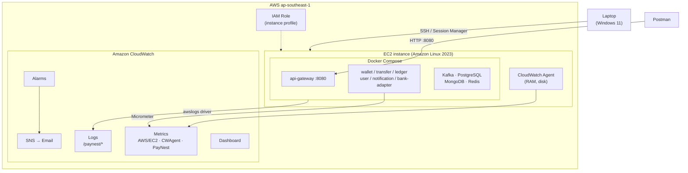
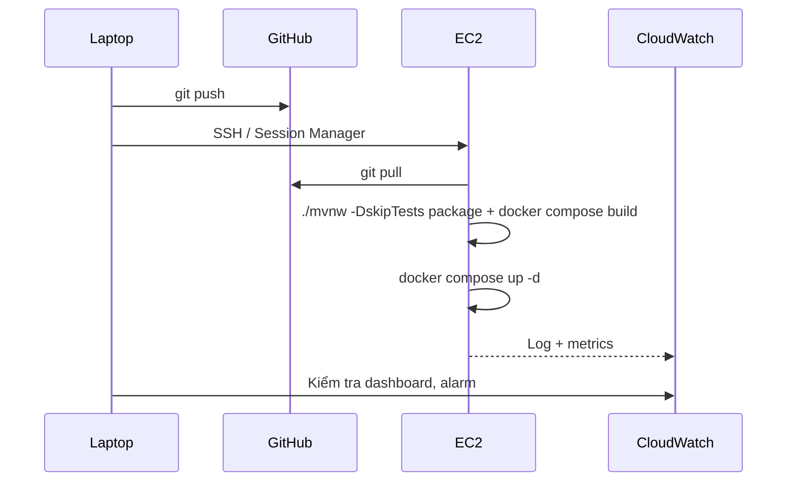

# ☁️ Deploy lên AWS EC2 + giám sát bằng CloudWatch

Hướng dẫn đưa dự án ví điện tử lên **một EC2 instance** chạy Docker Compose, đẩy **log và metrics** sang **CloudWatch**, đặt **cảnh báo** — và những **thay đổi code** cần làm.

> Đây là cách triển khai đơn giản nhất để học. Bước tiếp theo trong thực tế là ECS/EKS + RDS + MSK, nhưng EC2 giúp bạn hiểu rõ từng lớp trước.

---

## Mục lục

0. [Chuẩn bị & kiểm soát chi phí](#0-chuẩn-bị--kiểm-soát-chi-phí)
1. [Kiến trúc triển khai](#1-kiến-trúc-triển-khai)
2. [IAM Role cho EC2](#2-iam-role-cho-ec2)
3. [Tạo EC2 instance](#3-tạo-ec2-instance)
4. [Cài Docker trên EC2](#4-cài-docker-trên-ec2)
5. [Thay đổi code](#5-thay-đổi-code)
6. [Đẩy log container lên CloudWatch Logs](#6-đẩy-log-container-lên-cloudwatch-logs)
7. [CloudWatch Agent: RAM & disk của máy](#7-cloudwatch-agent-ram--disk-của-máy)
8. [Metrics ứng dụng từ Spring Boot](#8-metrics-ứng-dụng-từ-spring-boot)
9. [Alarm, Dashboard, Logs Insights](#9-alarm-dashboard-logs-insights)
10. [Deploy & cập nhật](#10-deploy--cập-nhật)
11. [Checklist](#11-checklist)
12. [Tài liệu chính thức](#12-tài-liệu-chính-thức)

---

## 0. Chuẩn bị & kiểm soát chi phí

### ⚠️ Free Tier đã thay đổi

Tài khoản AWS tạo **từ 15/07/2025** không còn mô hình "750 giờ EC2 miễn phí/tháng trong 12 tháng" mà chuyển sang **credit**:

- Nhận **$100 credit** khi đăng ký, kiếm thêm tối đa **$100** khi hoàn thành các hoạt động onboarding.
- **Free plan** hết hạn sau **6 tháng hoặc khi hết credit** (cái nào đến trước).
- EC2 chạy sẽ **trừ dần vào credit**.

Tài khoản tạo trước ngày đó giữ mô hình cũ. Kiểm tra loại tài khoản của bạn trong **Billing → Free Tier**.

### Việc làm ngay khi có tài khoản

1. Bật **MFA** cho root user, tạo IAM user riêng để làm việc hằng ngày.
2. Tạo **AWS Budget** (vd $10/tháng) với cảnh báo email ở 50% / 80% / 100%.
3. Chọn region gần Việt Nam: **`ap-southeast-1` (Singapore)**.
4. **Stop instance khi không dùng** — instance stop không tính tiền compute (EBS vẫn tính).

---

## 1. Kiến trúc triển khai



| Nguồn dữ liệu | Cách gửi | Đích |
|---|---|---|
| Log của từng container | Docker `awslogs` logging driver | CloudWatch Logs |
| CPU, network của máy | Có sẵn (miễn phí) | Namespace `AWS/EC2` |
| RAM, disk của máy | CloudWatch Agent | Namespace `CWAgent` |
| Metrics nghiệp vụ, JVM | Micrometer CloudWatch registry | Namespace `PayNest` |

---

## 2. IAM Role cho EC2

EC2 cần quyền ghi log/metrics. **Không bao giờ** copy access key vào máy — dùng IAM Role.

1. **IAM → Roles → Create role**
2. Trusted entity: **AWS service → EC2**
3. Gắn 2 managed policy:
   - `CloudWatchAgentServerPolicy` — ghi metrics và log lên CloudWatch
   - `AmazonSSMManagedInstanceCore` — cho phép kết nối bằng Session Manager (không cần mở port 22)
4. Đặt tên: `paynest-ec2-role`

---

## 3. Tạo EC2 instance

**EC2 → Launch instance:**

| Mục | Giá trị gợi ý | Ghi chú |
|---|---|---|
| Name | `paynest-dev` | |
| AMI | **Amazon Linux 2023** | Có sẵn CloudWatch Agent trong repo `dnf` |
| Instance type | **`t3.large`** (2 vCPU, 8GB) | Toàn bộ stack cần ~6–8GB RAM. Muốn rẻ hơn: `t3.medium` (4GB) và chỉ bật một phần service |
| Key pair | Tạo mới, tải file `.pem` | Cất kỹ, không commit lên Git |
| Storage | 30GB gp3 | Docker image + dữ liệu Kafka/DB |
| IAM instance profile | `paynest-ec2-role` | Ở mục *Advanced details* |

> Xem giá chính xác theo giờ tại trang EC2 Pricing cho region bạn chọn trước khi launch.

### Security Group (quan trọng)

| Type | Port | Source | Lý do |
|---|---|---|---|
| SSH | 22 | **My IP** | Chỉ máy bạn SSH vào được (bỏ hẳn nếu dùng Session Manager) |
| Custom TCP | 8080 | **My IP** | Gọi API gateway từ Postman |

> ❌ **Không** mở port Kafka (9092), PostgreSQL (5432), MongoDB (27017), Redis (6379) ra Internet. Chúng chỉ cần nói chuyện với nhau bên trong Docker network.

### Kết nối

```powershell
# Từ Windows (PowerShell)
ssh -i .\paynest-key.pem ec2-user@<PUBLIC_IP>
```

Hoặc: **EC2 → chọn instance → Connect → Session Manager** (chạy trên trình duyệt, không cần key).

---

## 4. Cài Docker trên EC2

```bash
sudo dnf update -y
sudo dnf install -y docker git
sudo systemctl enable --now docker
sudo usermod -aG docker ec2-user
# Thoát ra và SSH lại để quyền nhóm docker có hiệu lực
```

Docker Compose plugin chưa có trong repo mặc định của Amazon Linux 2023, cài thủ công:

```bash
sudo mkdir -p /usr/local/lib/docker/cli-plugins
sudo curl -SL "https://github.com/docker/compose/releases/latest/download/docker-compose-linux-$(uname -m)" \
  -o /usr/local/lib/docker/cli-plugins/docker-compose
sudo chmod +x /usr/local/lib/docker/cli-plugins/docker-compose

docker compose version
```

---

## 5. Thay đổi code

Mục tiêu: **chạy local vẫn như cũ**, chỉ khi bật profile `aws` mới gửi dữ liệu lên CloudWatch.

### 5.1 Tách cấu hình theo profile

```
src/main/resources/
├── application.yml        # chung
├── application-local.yml  # localhost, log dạng text dễ đọc
└── application-aws.yml    # log JSON, bật CloudWatch metrics
```

**Không hardcode** host/password — đọc từ biến môi trường:

```yaml
# application.yml
spring:
  datasource:
    url: jdbc:postgresql://${DB_HOST:localhost}:5432/${DB_NAME:wallet}
    username: ${DB_USER:wallet}
    password: ${DB_PASSWORD:wallet}
  kafka:
    bootstrap-servers: ${KAFKA_BOOTSTRAP:localhost:9092}

server:
  shutdown: graceful            # xử lý nốt request đang chạy khi container dừng

management:
  endpoints:
    web:
      exposure:
        include: health,info,metrics
  endpoint:
    health:
      probes:
        enabled: true
```

### 5.2 Log dạng JSON (structured logging)

Log JSON giúp CloudWatch Logs Insights lọc theo field (`level`, `traceId`, `transferId`...). Spring Boot 3.4+ hỗ trợ sẵn:

```yaml
# application-aws.yml
logging:
  structured:
    format:
      console: ecs     # hoặc: logstash, gelf
  level:
    root: INFO
```

Thêm thông tin nghiệp vụ vào log bằng MDC:

```java
try (var ignored = MDC.putCloseable("transferId", transfer.getId().toString())) {
    log.info("Transfer completed amount={}", transfer.getAmount());
}
```

> Không bao giờ log số thẻ, mật khẩu, JWT hay OTP.

### 5.3 Trace ID xuyên service (khuyến nghị)

```xml
<dependency>
  <groupId>io.micrometer</groupId>
  <artifactId>micrometer-tracing-bridge-otel</artifactId>
</dependency>
```

Khi có tracing, `traceId` tự động xuất hiện trong log → tìm toàn bộ hành trình của 1 giao dịch qua nhiều service bằng một câu query.

### 5.4 Thêm dependency CloudWatch metrics

```xml
<dependency>
  <groupId>io.micrometer</groupId>
  <artifactId>micrometer-registry-cloudwatch2</artifactId>
</dependency>
<dependency>
  <groupId>software.amazon.awssdk</groupId>
  <artifactId>cloudwatch</artifactId>
</dependency>
```

> `cloudwatch2` dùng AWS SDK v2 (bản nên dùng). `micrometer-registry-cloudwatch` là bản cũ cho SDK v1. Quản lý version AWS SDK bằng BOM `software.amazon.awssdk:bom`.

Cấu hình registry **chỉ bật ở profile `aws`**:

```java
@Configuration
@Profile("aws")
public class CloudWatchMetricsConfig {

    @Bean
    CloudWatchAsyncClient cloudWatchAsyncClient() {
        // Tự lấy region và credentials từ IAM Role của EC2
        return CloudWatchAsyncClient.create();
    }

    @Bean
    CloudWatchMeterRegistry cloudWatchMeterRegistry(CloudWatchAsyncClient client,
                                                    @Value("${spring.application.name}") String app) {
        CloudWatchConfig config = new CloudWatchConfig() {
            @Override public String get(String key) { return null; }
            @Override public String namespace() { return "PayNest"; }
            @Override public Duration step() { return Duration.ofMinutes(1); }
        };
        CloudWatchMeterRegistry registry =
            new CloudWatchMeterRegistry(config, Clock.SYSTEM, client);
        registry.config().commonTags("service", app);
        return registry;
    }

    // ⚠️ Mỗi custom metric (tên + bộ tag) tính tiền riêng → chỉ gửi những gì cần
    @Bean
    MeterFilter cloudWatchAllowList() {
        return MeterFilter.denyUnless(id ->
            id.getName().startsWith("paynest.")
         || id.getName().equals("jvm.memory.used")
         || id.getName().equals("http.server.requests"));
    }
}
```

### 5.5 Metrics nghiệp vụ

```java
@Service
@RequiredArgsConstructor
public class TransferMetrics {

    private final MeterRegistry registry;

    public void completed(Duration took) {
        registry.counter("paynest.transfer.completed").increment();
        registry.timer("paynest.transfer.latency").record(took);
    }

    public void failed(String reason) {
        // Giữ số giá trị tag nhỏ (vd INSUFFICIENT_FUNDS, TIMEOUT) để không bùng chi phí
        registry.counter("paynest.transfer.failed", "reason", reason).increment();
    }
}
```

### 5.6 Giới hạn bộ nhớ JVM trong container

```dockerfile
FROM eclipse-temurin:25-jre
WORKDIR /app
COPY target/*.jar app.jar
ENV JAVA_TOOL_OPTIONS="-XX:MaxRAMPercentage=75"
ENTRYPOINT ["java", "-jar", "app.jar"]
```

`MaxRAMPercentage` để JVM tự tính heap theo giới hạn RAM của container, tránh bị kill vì OOM.

### Tóm tắt thay đổi code

| # | Thay đổi | File |
|---|---|---|
| 1 | Tách profile `local` / `aws`, đọc config từ env | `application*.yml` |
| 2 | Log JSON + MDC | `application-aws.yml`, service code |
| 3 | Graceful shutdown, health probes | `application.yml` |
| 4 | Micrometer CloudWatch registry + allow-list | `pom.xml`, `CloudWatchMetricsConfig.java` |
| 5 | Metrics nghiệp vụ | `TransferMetrics.java` |
| 6 | Tracing (tùy chọn) | `pom.xml` |
| 7 | `MaxRAMPercentage`, `mem_limit` | `Dockerfile`, compose |

---

## 6. Đẩy log container lên CloudWatch Logs

Tạo file override riêng cho AWS, giữ nguyên `docker-compose.yml` dùng ở local:

```yaml
# infra/docker-compose.aws.yml
x-aws-logging: &aws-logging
  driver: awslogs
  options:
    awslogs-region: ap-southeast-1
    awslogs-group: /paynest/app
    awslogs-create-group: "true"
    tag: "{{.Name}}"            # mỗi container 1 log stream theo tên

x-spring-env: &spring-env
  SPRING_PROFILES_ACTIVE: aws
  KAFKA_BOOTSTRAP: kafka:9092

services:
  wallet-service:
    logging: *aws-logging
    environment:
      <<: *spring-env
      DB_HOST: wallet-db
    mem_limit: 768m

  transfer-service:
    logging: *aws-logging
    environment:
      <<: *spring-env
      DB_HOST: transfer-db
    mem_limit: 768m

  # ... lặp lại cho các service còn lại

  kafka:
    mem_limit: 1g
```

Chạy:

```bash
docker compose -f docker-compose.yml -f docker-compose.aws.yml up -d
```

Trên EC2, Docker tự lấy credentials từ IAM Role và tự nhận region của instance.

**Đặt thời gian lưu log** (mặc định là giữ vĩnh viễn → tốn tiền):
**CloudWatch → Log groups → `/paynest/app` → Actions → Edit retention → 7 days.**

> Lưu ý: khi dùng `awslogs`, lệnh `docker logs` có thể không còn đọc được log trên máy (tùy phiên bản Docker). Xem log trên CloudWatch Console là chính.

---

## 7. CloudWatch Agent: RAM & disk của máy

Mặc định EC2 chỉ có CPU, network, disk I/O — **không có RAM và % dung lượng disk**. Cần Agent.

```bash
sudo dnf install -y amazon-cloudwatch-agent
```

Tạo file cấu hình:

```bash
sudo tee /opt/aws/amazon-cloudwatch-agent/etc/amazon-cloudwatch-agent.json > /dev/null <<'EOF'
{
  "agent": { "metrics_collection_interval": 60 },
  "metrics": {
    "append_dimensions": { "InstanceId": "${aws:InstanceId}" },
    "metrics_collected": {
      "mem":  { "measurement": ["mem_used_percent"] },
      "disk": { "measurement": ["used_percent"], "resources": ["/"] }
    }
  }
}
EOF
```

Áp dụng và khởi động:

```bash
sudo /opt/aws/amazon-cloudwatch-agent/bin/amazon-cloudwatch-agent-ctl \
  -a fetch-config -m ec2 -s \
  -c file:/opt/aws/amazon-cloudwatch-agent/etc/amazon-cloudwatch-agent.json

sudo systemctl enable amazon-cloudwatch-agent
sudo systemctl status amazon-cloudwatch-agent
```

Sau vài phút, vào **CloudWatch → Metrics → All metrics → CWAgent** sẽ thấy `mem_used_percent` và `disk_used_percent`.

> Muốn cấu hình kiểu hỏi-đáp: chạy `sudo /opt/aws/amazon-cloudwatch-agent/bin/amazon-cloudwatch-agent-config-wizard`.

---

## 8. Metrics ứng dụng từ Spring Boot

Sau khi deploy với profile `aws` (mục 5.4–5.5), metrics xuất hiện tại **CloudWatch → Metrics → PayNest**, gửi mỗi 1 phút:

| Metric | Ý nghĩa |
|---|---|
| `paynest.transfer.completed` | Số giao dịch thành công |
| `paynest.transfer.failed` (tag `reason`) | Số giao dịch lỗi theo lý do |
| `paynest.transfer.latency` | Thời gian xử lý chuyển tiền |
| `http.server.requests` | Request HTTP theo status, URI |
| `jvm.memory.used` | Bộ nhớ JVM |

---

## 9. Alarm, Dashboard, Logs Insights

### 9.1 Kênh nhận cảnh báo

**SNS → Topics → Create topic** `paynest-alerts` → **Create subscription** (Email) → xác nhận email.

### 9.2 Alarm gợi ý

| Alarm | Metric | Điều kiện |
|---|---|---|
| CPU cao | `AWS/EC2 CPUUtilization` | > 80% trong 5 phút |
| RAM cao | `CWAgent mem_used_percent` | > 85% trong 5 phút |
| Disk gần đầy | `CWAgent disk_used_percent` | > 80% |
| Giao dịch lỗi tăng | `PayNest paynest.transfer.failed` | > 10 / phút |
| Máy chết | `AWS/EC2 StatusCheckFailed` | ≥ 1 |

Tạo tại **CloudWatch → Alarms → Create alarm** → chọn metric → điều kiện → action gửi tới `paynest-alerts`.

### 9.3 Đếm ERROR từ log (Metric filter)

**Log group `/paynest/app` → Actions → Create metric filter:**

- Filter pattern (log JSON): `{ $.log.level = "ERROR" }`
  (log dạng text thì dùng: `ERROR`)
- Metric namespace: `PayNest/Logs`, metric name: `ErrorCount`, value: `1`

Sau đó tạo alarm trên `ErrorCount`.

### 9.4 Logs Insights — query mẫu

```sql
-- 50 lỗi gần nhất
fields @timestamp, @logStream, @message
| filter @message like /ERROR/
| sort @timestamp desc
| limit 50
```

```sql
-- Theo dõi 1 giao dịch qua mọi service
fields @timestamp, @logStream, @message
| filter @message like /<transferId hoặc traceId>/
| sort @timestamp asc
```

```sql
-- Số lỗi theo service mỗi 5 phút
filter @message like /ERROR/
| stats count(*) as errors by @logStream, bin(5m)
```

### 9.5 Dashboard

**CloudWatch → Dashboards → Create** `paynest`, thêm widget:
CPU · RAM · Disk · `transfer.completed` vs `transfer.failed` · `transfer.latency` (p95) · `ErrorCount`.

---

## 10. Deploy & cập nhật



```bash
cd ~/paynest
git pull
./mvnw -q -DskipTests package
docker compose -f infra/docker-compose.yml -f infra/docker-compose.aws.yml up -d --build
```

**Nâng cấp sau này:** build image trong GitHub Actions → đẩy lên Amazon ECR → EC2 chỉ cần `docker compose pull && up -d`.

### Dọn dẹp khi học xong

- [ ] Stop hoặc **Terminate** EC2
- [ ] Xóa EBS volume và snapshot còn sót
- [ ] Release Elastic IP (nếu có — IP không gắn vào máy đang chạy vẫn tính tiền)
- [ ] Xóa log group hoặc để retention ngắn

---

## 11. Checklist

**AWS**
- [ ] MFA cho root, IAM user riêng
- [ ] AWS Budget + cảnh báo email
- [ ] IAM Role `paynest-ec2-role` (CloudWatchAgentServerPolicy + AmazonSSMManagedInstanceCore)
- [ ] EC2 Amazon Linux 2023, Security Group chỉ mở 22 / 8080 cho My IP
- [ ] Docker + Compose plugin
- [ ] CloudWatch Agent chạy, thấy `mem_used_percent`
- [ ] Log group `/paynest/app`, retention 7 ngày
- [ ] SNS email + ít nhất 3 alarm
- [ ] Dashboard `paynest`

**Code**
- [ ] Profile `local` / `aws`, config đọc từ env
- [ ] Structured logging JSON ở profile `aws`
- [ ] `server.shutdown: graceful`
- [ ] `micrometer-registry-cloudwatch2` + `MeterFilter` allow-list
- [ ] Metrics nghiệp vụ `paynest.*`
- [ ] `MaxRAMPercentage` + `mem_limit`
- [ ] `docker-compose.aws.yml` với `awslogs`

---

## 12. Tài liệu chính thức

**AWS**
- AWS Free Tier — https://aws.amazon.com/free/
- Thông báo Free Tier mới (07/2025) — https://aws.amazon.com/about-aws/whats-new/2025/07/aws-free-tier-credits-month-free-plan/
- Amazon EC2 User Guide — https://docs.aws.amazon.com/AWSEC2/latest/UserGuide/
- Cài CloudWatch Agent — https://docs.aws.amazon.com/AmazonCloudWatch/latest/monitoring/install-CloudWatch-Agent-on-EC2-Instance.html
- CloudWatch Logs Insights query syntax — https://docs.aws.amazon.com/AmazonCloudWatch/latest/logs/CWL_QuerySyntax.html
- Session Manager — https://docs.aws.amazon.com/systems-manager/latest/userguide/session-manager.html
- AWS Budgets — https://docs.aws.amazon.com/cost-management/latest/userguide/budgets-managing-costs.html
- CloudWatch Pricing — https://aws.amazon.com/cloudwatch/pricing/

**Docker**
- Amazon CloudWatch Logs logging driver — https://docs.docker.com/engine/logging/drivers/awslogs/

**Spring / Micrometer**
- Micrometer CloudWatch — https://docs.micrometer.io/micrometer/reference/implementations/cloudwatch.html
- Spring Boot Logging (Structured logging) — https://docs.spring.io/spring-boot/reference/features/logging.html
- Spring Boot Actuator — https://docs.spring.io/spring-boot/reference/actuator/index.html
