# Architecture — Class Diagrams

Class-level view of PayNest, derived from the code in `libs/` and `services/`. It describes what is implemented today. For intended behaviour see [product-spec.md](product-spec.md); for where the code differs from the README diagrams see [§13](#13-differences-from-the-readme-diagrams).

## Contents

1. [Module map](#1-module-map)
2. [How to read the diagrams](#2-how-to-read-the-diagrams)
3. [common-events](#3-common-events)
4. [outbox](#4-outbox)
5. [common-web](#5-common-web)
6. [user-service](#6-user-service)
7. [wallet-service](#7-wallet-service)
8. [transfer-service](#8-transfer-service)
9. [ledger-service](#9-ledger-service)
10. [notification-service](#10-notification-service)
11. [bank-adapter and api-gateway](#11-bank-adapter-and-api-gateway)
12. [How the services connect](#12-how-the-services-connect)
13. [Differences from the README diagrams](#13-differences-from-the-readme-diagrams)

---

## 1. Module map

Maven dependencies between modules. Services never depend on each other's code: they share only `libs/`.

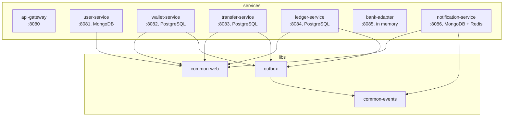

`api-gateway` and `bank-adapter` use no shared library. The gateway is reactive, and `common-web` is servlet-based, so the gateway keeps its own `JwtProperties` and `SecurityConfig`.

## 2. How to read the diagrams

| Notation | Meaning |
|---|---|
| `A --> B` | A holds B as an injected field |
| `A ..> B` | A creates, returns or reads B without holding it. Label `nested` means B is a record nested inside A |
| `A <.. B : someId` | B refers to A **by id only**; there is no object reference or JPA association |
| `A ..\|> B` | A implements interface B |
| `<<lib>>` | Class from a shared library; its members are in that library's section |
| `<<entity>>` / `<<document>>` | JPA entity (PostgreSQL) / Spring Data document (MongoDB) |
| `<<JpaRepository>>` / `<<MongoRepository>>` | Repository interface extending that Spring Data type; only its own query methods are listed |

To keep the diagrams readable, they leave out getters, constructors, loggers, private helper methods and the one-line `*Application` main classes. Injected dependencies appear as arrows, not as fields. Amounts are `long` integer minor units.

---

## 3. common-events

Package `com.paynest.events`. The wire format for everything on Kafka.

`Message` is a sealed interface: `EventCodec` discovers the payload types from its permitted subclasses and uses each simple class name as the wire name. All payloads are records nested in `WalletMessages`, `LedgerMessages` or `TransferMessages`, shown below as namespaces.

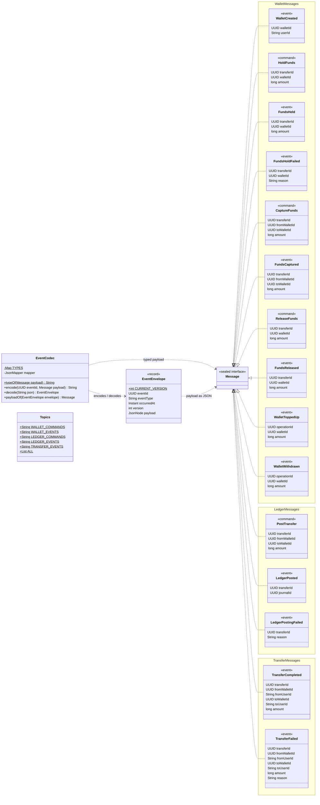

---

## 4. outbox

Package `com.paynest.outbox`. Transactional outbox and idempotent inbox, used by the three PostgreSQL services. Each of them owns its `outbox` and `processed_events` tables in its own `V1__init.sql`.

- `OutboxWriter.append` and `Inbox.markProcessed` use `Propagation.MANDATORY`, so they fail if called outside the business transaction.
- `OutboxRelay` is on by default and turned off with `paynest.outbox.relay-enabled=false`, for when Debezium CDC publishes the outbox instead.
- `MessagingConfig` also sets the blocking retry policy for saga listeners: up to 6 retries with exponential backoff, then `<topic>.dlt`. Parse errors skip the retries.

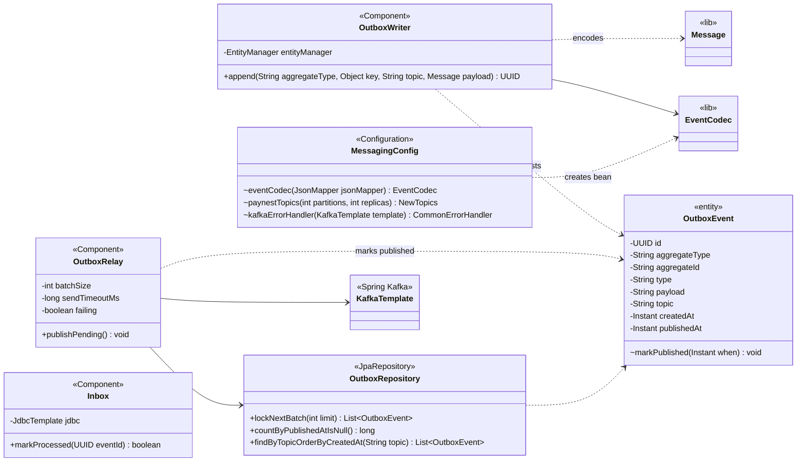

---

## 5. common-web

Package `com.paynest.web`. Security and error handling for the servlet services. Services throw `ApiException` from controllers and services; to keep the diagrams clean, those arrows are not repeated in the service sections.

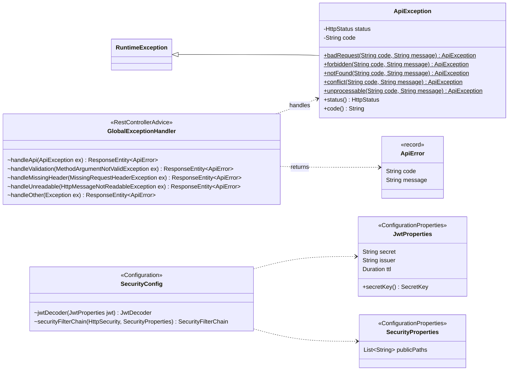

---

## 6. user-service

Package `com.paynest.user`. Registration, login and simulated KYC, stored in MongoDB. It is the only service that signs JWTs. It has no Kafka dependency.

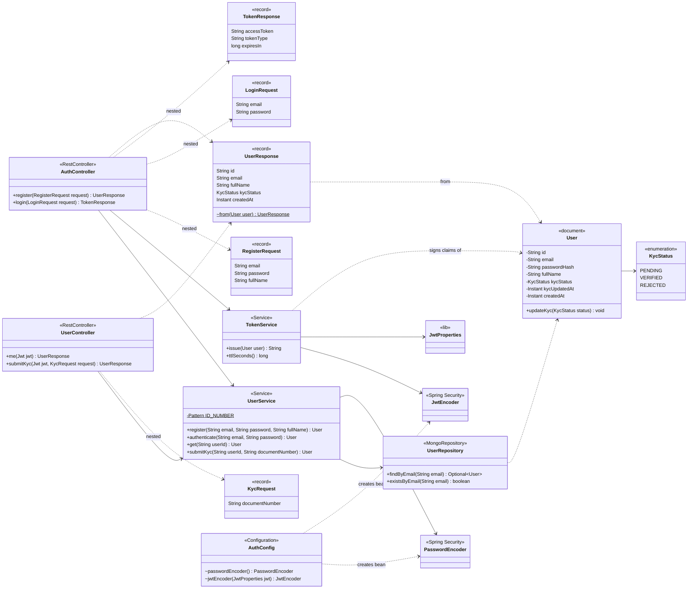

---

## 7. wallet-service

Package `com.paynest.wallet`. Balances, holds, top-up and withdrawal, stored in PostgreSQL.

- **`WalletService`** handles user requests. A bank call never runs inside a DB transaction: it records the operation, calls the bank, then applies the result.
- **`WalletCommandService`** handles saga commands. Each command runs in one transaction with its reply event (outbox) and processed-event mark (inbox).
- **`Wallet`** invariants: `available = balance - held`. `wallets` has DB checks for `balance >= 0` and `0 <= held <= balance`.

```mermaid
classDiagram
    direction LR

    class WalletController {
        <<RestController>>
        +me(Jwt jwt) WalletResponse
        +topUp(Jwt, String idempotencyKey, AmountRequest) WalletResponse
        +withdraw(Jwt, String idempotencyKey, AmountRequest) WalletResponse
        +transactions(Jwt jwt) List~TransactionResponse~
    }
    class AmountRequest {
        <<record>>
        Long amount
    }
    class WalletResponse {
        <<record>>
        UUID id
        String userId
        String currency
        long balance
        long held
        long available
        Instant updatedAt
    }
    class TransactionResponse {
        <<record>>
        UUID id
        TransactionType type
        long amount
        String reference
        long balanceAfter
        Instant createdAt
    }
    class WalletService {
        <<Service>>
        ~String AGGREGATE$
        -int MAX_CONFLICT_RETRIES$
        -String currency
        +getOrCreate(String userId) Wallet
        +history(String userId) List~WalletTransaction~
        +topUp(String userId, String idempotencyKey, long amount) Wallet
        +withdraw(String userId, String idempotencyKey, long amount) Wallet
    }
    class WalletCommandListener {
        <<KafkaListener>>
        +onMessage(String message) void
    }
    class WalletCommandService {
        <<Service>>
        -String AGGREGATE$
        +handle(EventEnvelope envelope) void
    }
    class BankClient {
        <<Component>>
        -RestClient rest
        -int maxAttempts
        -Duration backoff
        +charge(UUID reference, long amount) BankResult
        +payout(UUID reference, long amount) BankResult
    }
    class BankRequest {
        <<record>>
        UUID reference
        long amount
    }
    class BankResult {
        <<record>>
        Outcome outcome
        String reason
        +ok() BankResult$
        +declined(String reason) BankResult$
        +unavailable(String reason) BankResult$
        +isOk() boolean
    }
    class Outcome["BankResult.Outcome"] {
        <<enumeration>>
        OK
        DECLINED
        UNAVAILABLE
    }
    class Wallet {
        <<entity>>
        -UUID id
        -String userId
        -String currency
        -long balance
        -long held
        -long version
        -Instant createdAt
        -Instant updatedAt
        +available() long
        +credit(long amount) void
        +hold(long amount) void
        +release(long amount) void
        +capture(long amount) void
    }
    class WalletTransaction {
        <<entity>>
        -UUID id
        -UUID walletId
        -TransactionType type
        -long amount
        -String reference
        -long balanceAfter
        -Instant createdAt
        +of(Wallet, TransactionType, long amount, Object reference) WalletTransaction$
    }
    class TransactionType {
        <<enumeration>>
        TOPUP
        WITHDRAW
        HOLD
        RELEASE
        TRANSFER_OUT
        TRANSFER_IN
    }
    class BankOperation {
        <<entity>>
        -UUID id
        -UUID walletId
        -Type type
        -long amount
        -String idempotencyKey
        -Status status
        -String failureReason
        -long version
        -Instant createdAt
        -Instant updatedAt
        +isPending() boolean
        +matches(Type type, long amount) boolean
        +complete() void
        +fail(String reason) void
    }
    class BankOperationType["BankOperation.Type"] {
        <<enumeration>>
        TOPUP
        WITHDRAW
    }
    class BankOperationStatus["BankOperation.Status"] {
        <<enumeration>>
        PENDING
        COMPLETED
        FAILED
    }
    class InsufficientFundsException
    class RuntimeException
    class WalletRepository {
        <<JpaRepository>>
        +findByUserId(String userId) Optional~Wallet~
    }
    class WalletTransactionRepository {
        <<JpaRepository>>
        +findTop50ByWalletIdOrderByCreatedAtDesc(UUID walletId) List~WalletTransaction~
        +existsByWalletIdAndTypeAndReference(UUID, TransactionType, String) boolean
    }
    class BankOperationRepository {
        <<JpaRepository>>
        +findByWalletIdAndIdempotencyKey(UUID walletId, String idempotencyKey) Optional~BankOperation~
    }
    class OutboxWriter {
        <<lib>>
    }
    class Inbox {
        <<lib>>
    }
    class EventCodec {
        <<lib>>
    }

    WalletController --> WalletService
    WalletController ..> AmountRequest : nested
    WalletController ..> WalletResponse : nested
    WalletController ..> TransactionResponse : nested

    WalletService --> WalletRepository
    WalletService --> WalletTransactionRepository
    WalletService --> BankOperationRepository
    WalletService --> OutboxWriter
    WalletService --> BankClient

    WalletCommandListener --> WalletCommandService
    WalletCommandListener --> EventCodec
    WalletCommandService --> WalletRepository
    WalletCommandService --> WalletTransactionRepository
    WalletCommandService --> OutboxWriter
    WalletCommandService --> Inbox
    WalletCommandService --> EventCodec

    BankClient ..> BankResult : returns
    BankClient ..> BankRequest : nested
    BankResult --> Outcome

    WalletRepository ..> Wallet
    WalletTransactionRepository ..> WalletTransaction
    BankOperationRepository ..> BankOperation

    Wallet "1" <.. "*" WalletTransaction : walletId
    Wallet "1" <.. "*" BankOperation : walletId
    WalletTransaction --> TransactionType
    BankOperation --> BankOperationType
    BankOperation --> BankOperationStatus
    Wallet ..> InsufficientFundsException : hold() throws
    RuntimeException <|-- InsufficientFundsException
```

---

## 8. transfer-service

Package `com.paynest.transfer`. Saga orchestrator for transfers, stored in PostgreSQL.

- **`TransferService`** stores the `PENDING` transfer and the first command (`HoldFunds`) in one transaction, then returns 202. `transfers` has a unique key on `(from_user_id, idempotency_key)`.
- **`TransferSaga`** moves the transfer one step for each reply and emits the next command through the outbox. It only acts when the transfer is in the expected state, so late or replayed replies do nothing.
- **`WalletDirectoryEntry`** is a local read model of wallet ownership, fed by `WalletCreated` events, so a transfer needs no call to wallet-service.

```mermaid
classDiagram
    direction LR

    class TransferController {
        <<RestController>>
        +create(Jwt jwt, String idempotencyKey, CreateTransferRequest request) ResponseEntity~TransferResponse~
        +get(Jwt jwt, UUID id) TransferResponse
        +list(Jwt jwt) List~TransferResponse~
    }
    class CreateTransferRequest {
        <<record>>
        UUID toWalletId
        Long amount
    }
    class TransferResponse {
        <<record>>
        UUID id
        TransferStatus status
        UUID fromWalletId
        UUID toWalletId
        long amount
        String failureReason
        Instant createdAt
        Instant updatedAt
    }
    class TransferService {
        <<Service>>
        +create(String userId, String idempotencyKey, UUID toWalletId, long amount) Transfer
        +get(String userId, UUID transferId) Transfer
        +list(String userId) List~Transfer~
    }
    class SagaReplyListener {
        <<KafkaListener>>
        +onMessage(String message) void
    }
    class TransferSaga {
        <<Service>>
        ~String AGGREGATE$
        +handle(EventEnvelope envelope) void
    }
    class Transfer {
        <<entity>>
        -UUID id
        -String idempotencyKey
        -String fromUserId
        -UUID fromWalletId
        -String toUserId
        -UUID toWalletId
        -long amount
        -TransferStatus status
        -String failureReason
        -long version
        -Instant createdAt
        -Instant updatedAt
        +transitionTo(TransferStatus next) void
        +transitionTo(TransferStatus next, String reason) void
        +isSameRequest(UUID toWalletId, long amount) boolean
        +involves(String userId) boolean
    }
    class TransferStatus {
        <<enumeration>>
        PENDING
        HELD
        COMPLETED
        COMPENSATING
        FAILED
        +canTransitionTo(TransferStatus next) boolean
        +isFinal() boolean
    }
    class WalletDirectoryEntry {
        <<entity>>
        -UUID walletId
        -String userId
        -Instant createdAt
    }
    class TransferRepository {
        <<JpaRepository>>
        +findByFromUserIdAndIdempotencyKey(String fromUserId, String idempotencyKey) Optional~Transfer~
        +findTop50ByFromUserIdOrToUserIdOrderByCreatedAtDesc(String fromUserId, String toUserId) List~Transfer~
    }
    class WalletDirectoryRepository {
        <<JpaRepository>>
        +findByUserId(String userId) Optional~WalletDirectoryEntry~
    }
    class OutboxWriter {
        <<lib>>
    }
    class Inbox {
        <<lib>>
    }
    class EventCodec {
        <<lib>>
    }

    TransferController --> TransferService
    TransferController ..> CreateTransferRequest : nested
    TransferController ..> TransferResponse : nested

    TransferService --> TransferRepository
    TransferService --> WalletDirectoryRepository
    TransferService --> OutboxWriter
    TransferService ..> TransferSaga : reads AGGREGATE

    SagaReplyListener --> TransferSaga
    SagaReplyListener --> EventCodec
    TransferSaga --> TransferRepository
    TransferSaga --> WalletDirectoryRepository
    TransferSaga --> OutboxWriter
    TransferSaga --> Inbox
    TransferSaga --> EventCodec

    TransferRepository ..> Transfer
    WalletDirectoryRepository ..> WalletDirectoryEntry
    Transfer --> TransferStatus
```

`TransferSaga.handle` reply table:

| Reply | Expected status | New status | Message emitted |
|---|---|---|---|
| `WalletCreated` | n/a | n/a | none; adds a `WalletDirectoryEntry` |
| `FundsHeld` | `PENDING` | `HELD` | `PostTransfer` |
| `FundsHoldFailed` | `PENDING` | `FAILED` | `TransferFailed` |
| `LedgerPosted` | `HELD` | `HELD` | `CaptureFunds` |
| `LedgerPostingFailed` | `HELD` | `COMPENSATING` | `ReleaseFunds` |
| `FundsCaptured` | `HELD` | `COMPLETED` | `TransferCompleted` |
| `FundsReleased` | `COMPENSATING` | `FAILED` | `TransferFailed` |

---

## 9. ledger-service

Package `com.paynest.ledger`. Double-entry ledger, stored in PostgreSQL.

- **`LedgerService.post`** writes one journal per reference and rejects unbalanced postings. `journals.reference` is unique.
- **Database enforcement:** triggers block `UPDATE`, `DELETE` and `TRUNCATE` on both tables, and a deferred trigger checks that each journal balances at commit.
- **`Accounts`** builds account names: `wallet:<walletId>` and `external:bank`.

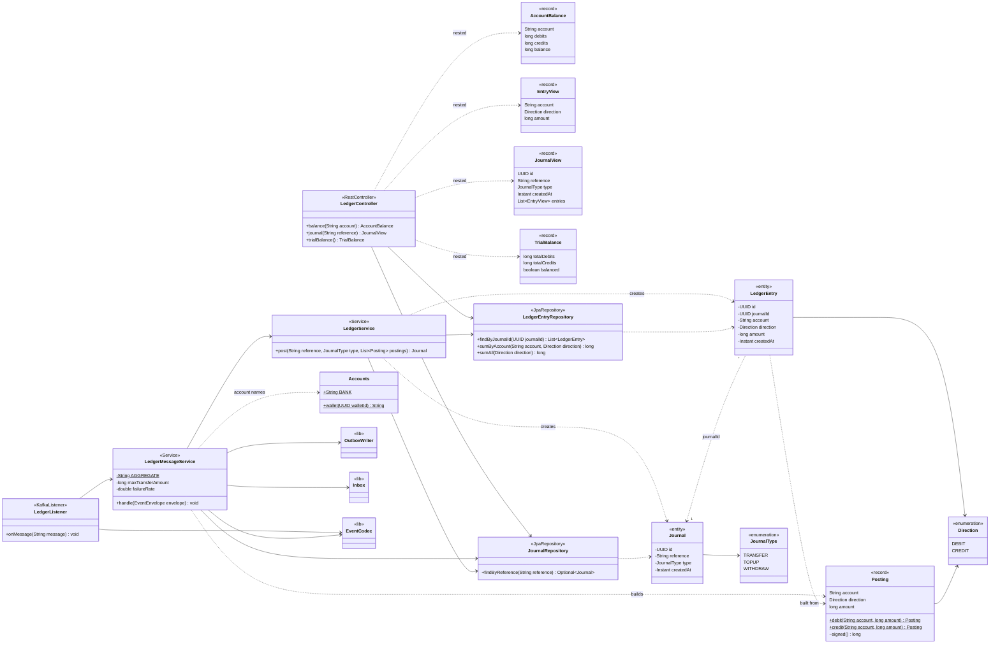

---

## 10. notification-service

Package `com.paynest.notification`. Consumes transfer outcomes and delivers notifications, stored in MongoDB, with preferences cached in Redis.

- It uses `common-events` directly, not the `outbox` library: it publishes nothing and has its own `MessagingConfig`.
- **`TransferEventListener`** uses non-blocking retry topics (`.retry`), then `.dlt`, where `onDeadLetter` stores a `DeadLetter`.
- **Idempotency** works in two ways: `ProcessedEvent` skips handled events, and `Notification.idFor(event, user, channel)` gives each channel a fixed id, so a retry only re-sends the channels that failed.
- **`NotificationSender`** implementations run in `@Order`: in-app, email, push. Email and push only log, and email can simulate failures.

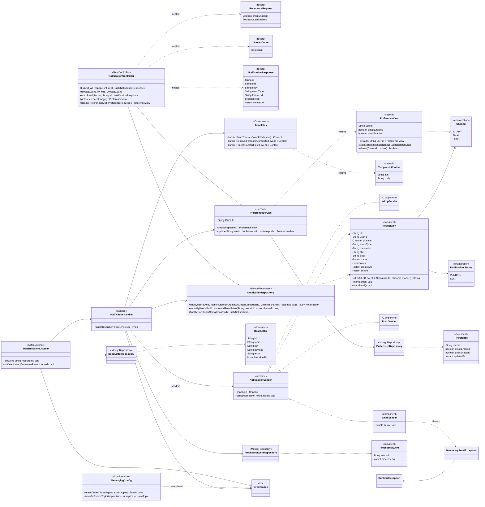

---

## 11. bank-adapter and api-gateway

**bank-adapter** (package `com.paynest.bank`) is a fake bank that fails on purpose. Its state is in memory and it is idempotent on `reference`. The gateway does not route to it, and only `BankClient` in wallet-service calls it.

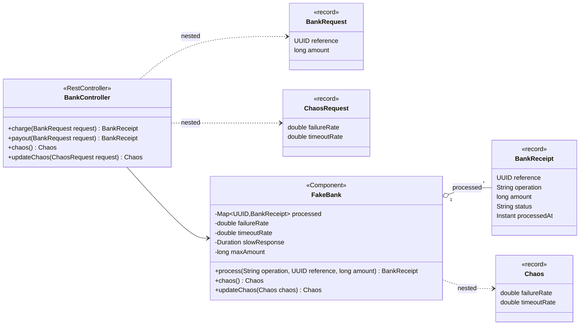

**api-gateway** (package `com.paynest.gateway`) is a reactive Spring Cloud Gateway. Its routes and rate-limit filter are configured in `application.yml`, so it has very little code.

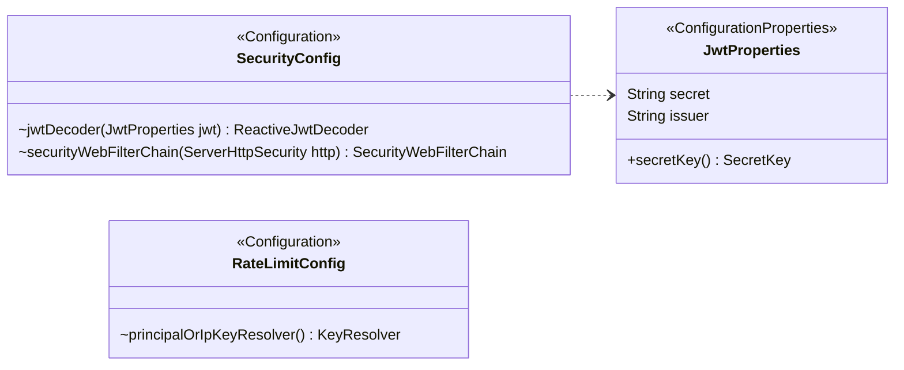

---

## 12. How the services connect

No service calls another's classes. The links between them are Kafka topics, one internal HTTP call, and the gateway routes.

**Kafka.** Topic names are in `Topics`. Wallet, transfer and ledger services publish through `OutboxWriter` and drop duplicates with `Inbox`. notification-service only consumes, and drops duplicates with `ProcessedEvent`.

| Topic | Message key | Message | Published by | Consumed by |
|---|---|---|---|---|
| `wallet.commands` | wallet id | `HoldFunds` | `TransferService` | `WalletCommandListener` |
| | | `CaptureFunds`, `ReleaseFunds` | `TransferSaga` | |
| `wallet.events` | wallet id | `WalletCreated`, `WalletToppedUp`, `WalletWithdrawn` | `WalletService` | `SagaReplyListener`, `LedgerListener` |
| | | `FundsHeld`, `FundsHoldFailed`, `FundsCaptured`, `FundsReleased` | `WalletCommandService` | |
| `ledger.commands` | transfer id | `PostTransfer` | `TransferSaga` | `LedgerListener` |
| `ledger.events` | transfer id | `LedgerPosted`, `LedgerPostingFailed` | `LedgerMessageService` | `SagaReplyListener` |
| `wallet.transfer.events` | transfer id | `TransferCompleted`, `TransferFailed` | `TransferSaga` | `TransferEventListener` |

Each listener reads every message on its topics and ignores the types it does not handle. For example, `LedgerMessageService` acts only on `PostTransfer`, `WalletToppedUp` and `WalletWithdrawn`.

**Internal HTTP.** `BankClient` (wallet-service) calls `POST /bank/charges` and `POST /bank/payouts` on `BankController` (bank-adapter), sending the `BankOperation` id as the idempotent `reference`.

**Gateway routes.** Every route except `/auth/**` needs a valid JWT. Each target service validates the JWT again itself.

| Path | Target controller |
|---|---|
| `/auth/**` | `AuthController` |
| `/users/**` | `UserController` |
| `/wallets/**` | `WalletController` |
| `/transfers/**` | `TransferController` |
| `/ledger/**` | `LedgerController` |
| `/notifications/**`, `/preferences/**` | `NotificationController` |

---

## 13. Differences from the README diagrams

The README §1 overview differs from the code in these places. The diagrams in this document follow the code.

| Topic | README §1 | Code |
|---|---|---|
| bank-adapter | Consumes from Kafka | HTTP only: `BankClient` calls `BankController`. The module has no Kafka dependency |
| Redis | Used by wallet and transfer services | Used by `api-gateway` (rate limiting) and `notification-service` (preference cache) |
| Gateway routes | User, wallet and transfer services | Also routes `/ledger/**`, `/notifications/**` and `/preferences/**` |
